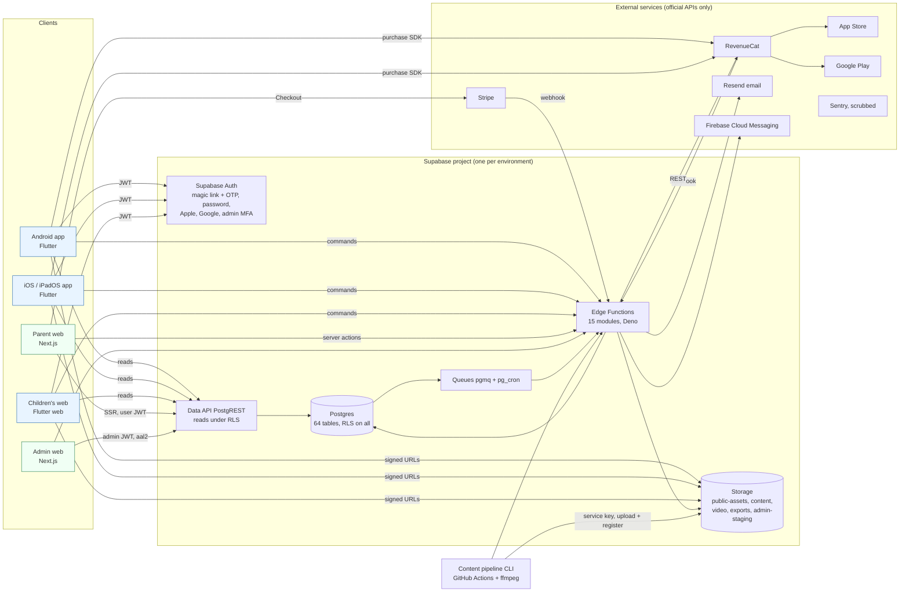
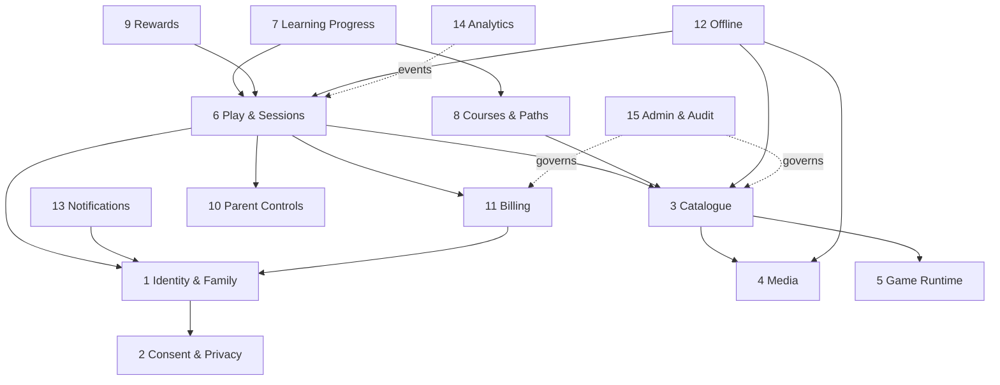

# 1. System architecture and module architecture

## 1.1 Platforms [D]

| platform | built with | who uses it | recon screens |
| --- | --- | --- | --- |
| Android app | Flutter (`apps/kids_app`) | children (Kids Area) and parents (Parents Area behind the gate) | S01–S46 |
| iOS / iPadOS app | Flutter (`apps/kids_app`) | same | S01–S46 |
| **Children's web app** | **Flutter web** build of the same app [P, D1] | children on Chromebooks, laptops, tablet browsers | Kids Area S09–S25, S44–S46 |
| Parent web dashboard | Next.js (`apps/parent-web`) | parents | S26–S37 as web pages, plus web sign-up and billing (S01–S08) |
| Admin web dashboard | Next.js (`apps/admin-web`) | staff: content, support, finance, privacy | new (the original's CMS is not public) |

On the web, the children's app links to the parent dashboard (after the parental gate) instead of carrying its own Parents Area. On mobile the Parents Area stays inside the app, as in the original [V SS-16]. This is the one deliberate difference between mobile and web.

## 1.2 Overall system diagram



**Request paths:**
- **Read** (feeds, profiles, catalogue): app → Data API → Postgres, filtered by RLS. Parent web does the same on the server (React Server Components with the user's cookie JWT).
- **Command** (finish an activity, claim a gift, add a child, buy): app → Edge Function → checks → one database transaction → response with the new state.
- **Files**: app → Edge Function asks for access → signed URL (minutes) → Storage. Public thumbnails come from the public bucket through the CDN.
- **Async**: webhooks and scheduled work → queue → job route on an Edge Function. Retries are idempotent.

## 1.3 Stack [D unless marked]

| layer | technology | notes |
| --- | --- | --- |
| Mobile + children's web | Flutter (stable channel), Dart 3, Riverpod 3 (with code generation), go_router, freezed/json_serializable, Drift (SQLite) | Clean Architecture per feature, see `02-…` |
| Games | Flame, flame_audio, flame_forge2d (only where physics is needed), Rive (characters, reactions), Lottie (UI celebrations) | Unity: not in v1 [P, D5] |
| Web dashboards | Next.js (App Router), TypeScript (strict), Tailwind CSS, `@supabase/ssr`, zod, react-hook-form, TanStack Table [P] | two apps: parent and admin |
| Backend | Supabase: Postgres, Auth, Storage, Edge Functions (Deno + Hono router [P]), Queues (pgmq), pg_cron, pg_net | modular monolith, see `04-…` |
| Payments | RevenueCat (`purchases_flutter`) for App Store and Google Play, Stripe Checkout + Billing on the web [P, D3] | |
| Email | Resend as Supabase Auth's SMTP and for transactional email [P] | own domain, SPF/DKIM/DMARC |
| Push | Firebase Cloud Messaging (`firebase_messaging` only; **Firebase Analytics not included**) [P] | parents only |
| Errors | Sentry with PII scrubbing, no user IDs on child surfaces [P, A: acceptable under Kids-category rules, to verify] | |
| Hosting | Supabase Cloud; Vercel for both Next.js apps and the Flutter web build; Codemagic for mobile builds [P] | see `15-…` |
| Repo | one git monorepo: Dart pub workspace + Melos for Flutter packages, pnpm workspace for Next.js, `supabase/` folder [P] | |

## 1.4 Repository layout [P]

```
kids-learning-platform/
├── apps/
│   ├── kids_app/            Flutter: Android, iOS, web (children + mobile Parents Area)
│   ├── parent-web/          Next.js: parent dashboard, web sign-up, web billing
│   └── admin-web/           Next.js: CMS, support, finance, privacy, audit
├── packages/
│   ├── dart/
│   │   ├── kl_core/         pure Dart: Result, Failure, ids, clock, validation
│   │   ├── kl_models/       freezed entities + DTOs shared by app and game runtime
│   │   ├── kl_design/       design tokens + Flutter widgets (kid and parent)
│   │   ├── kl_api/          Supabase + Edge Function clients, generated DTOs
│   │   ├── kl_offline/      Drift DB, outbox, sync engine, download manager
│   │   ├── kl_game_runtime/ GameHost, template contract, asset + audio loaders
│   │   ├── kl_game_templates/ E1..E12 (one folder each)
│   │   └── kl_analytics/    first-party event queue
│   └── ts/
│       ├── ui/              shared React components + Tailwind preset
│       ├── supabase/        generated DB types, typed clients, Edge Function client
│       └── config/          eslint, tsconfig, tailwind base
├── supabase/
│   ├── migrations/          0001_init.sql = approved schema-draft.sql
│   ├── functions/           15 Edge Functions + _shared/
│   ├── tests/               pgTAP: RLS, constraints, engine functions
│   └── seed/                dev seed data (no real people)
├── content/                 content pipeline CLI, pack manifests, sample packs
├── tools/template_playground/  Flutter app to preview any activity (QA + admin preview)
└── docs/
```

## 1.5 Application module architecture

The platform is **one deployable backend (Supabase) and three client apps**, split into **business modules**. Each module owns its tables, its Edge Function routes, its Flutter feature folder and its Next.js section. Modules call each other only through the owning module's functions, never by writing another module's tables.

| # | module | owns tables | Edge Function | Flutter feature | Next.js | recon |
| --- | --- | --- | --- | --- | --- | --- |
| 1 | **Identity & Family** | parent_accounts, parent_profiles, child_profiles, avatars, devices | `account`, `onboarding`, `children` | onboarding, auth, child_profiles | parent: settings, children | S01–S06, S26, S37; F01–F03, F13 |
| 2 | **Consent & Privacy** | parental_consents, data_export_requests, deletion_requests | `account` (consents, export, deletion), `jobs` | parents_area/privacy | parent: privacy; admin: privacy requests | F21 |
| 3 | **Catalogue & Content** | categories, subjects, skills, activities, activity_*, games, questions, answers, collections, collection_items | `catalog`, `admin` | catalog (home, collections, search) | admin: content | S09–S12, S14, S21; F04, F06, F07 |
| 4 | **Media** | media_assets | `media`, `admin` (upload) | player (video, audio, story) | admin: media library | S15, S16, S44 |
| 5 | **Game Runtime** | game_templates (+ games config) | — (client-side) | player/game, `kl_game_runtime`, `kl_game_templates` | admin: template + preview | S13; G01–G39 |
| 6 | **Play & Sessions** | activity_sessions, activity_results, question_responses, daily_free_allocations | `play` | player | — | F04, F09 |
| 7 | **Learning Progress** | skill_mastery, daily_progress, lesson_step_completions, course_enrollments, certificates, child_learning_paths | `play` (engine), `learning`, `progress` | courses, progress | parent: progress | S17–S20, S32, S46; F08, F12, F25 |
| 8 | **Courses & Paths** | courses, course_modules, lessons, lesson_steps, learning_paths, learning_path_courses | `learning`, `admin` | courses | admin: courses, paths | S17–S20 |
| 9 | **Rewards** | reward_sets, rewards, star_awards, gift_claims, child_rewards, scene_placements | `rewards`, `play` (stars) | rewards | — | S23–S25; F05 |
| 10 | **Parent Controls** | screen_time_rules, screen_time_usage | `children`, `play` (heartbeat) | parents_area/screen_time | parent: screen time | S30, S33, S34; F14 |
| 11 | **Billing** | subscription_plans, subscriptions, payments, entitlements, billing_webhook_events, promo_codes, promo_redemptions | `billing`, `webhooks`, `jobs` | subscription | parent: subscription; admin: billing | S04, S07, S08, S29, S35; F02, F17–F19 |
| 12 | **Offline & Downloads** | content_downloads | `library`, `catalog` (sync) | downloads, `kl_offline` | — | S36; F15 |
| 13 | **Notifications** | notifications, notification_preferences | `account`, `jobs` | parents_area/notifications | parent: notifications | — |
| 14 | **Analytics** | analytics.events | `analytics`, `jobs` | `kl_analytics` | admin: reports | — |
| 15 | **Admin, RBAC & Audit** | admin_users, admin_roles, admin_permissions, admin_role_permissions, admin_user_roles, audit_logs, feature_flags | `admin` | — | admin: users, roles, audit, flags | — |

### Module dependencies



**Module rules:**
1. **Ownership.** A table is written only by its module (through SQL functions in `private` or that module's Edge Function code in `supabase/functions/_shared/modules/<module>/`).
2. **Cross-module calls** go through the owner's TypeScript service in `_shared/modules` (in-process, the same deploy) or the owner's SQL function. No HTTP between our own functions.
3. **Each module is testable alone**: pgTAP tests for its tables and functions, Deno tests for its service, Flutter tests for its feature folder.
4. **No microservices** [D]. If a module ever needs to scale separately, its boundary is already drawn.
