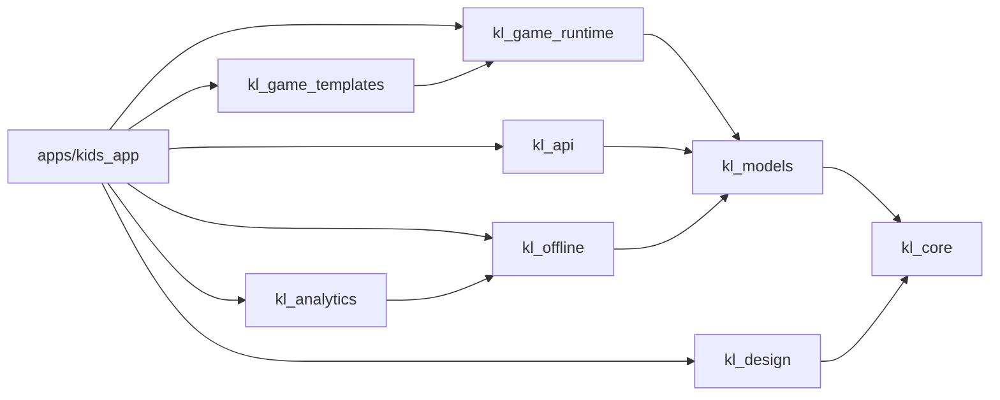

# 2. Flutter architecture (Android, iOS, children's web)

One Flutter app, `apps/kids_app`, builds for Android, iOS and the web [P, D1]. It contains the Kids Area (landscape [V SS-01]) and, on mobile, the Parents Area (portrait on phones [V SS-16]). Shared logic lives in Dart packages under `packages/dart/`.

## 2.1 Principles

- **Clean Architecture per feature**: `presentation → domain ← data`. The domain layer is pure Dart: no Flutter, Supabase or Drift imports. A lint rule (`import_lint` or a custom `custom_lint` rule) enforces it in CI. [P]
- **Riverpod 3 with code generation** (`riverpod_generator`) for dependency injection and state. No other DI container. [D]
- **Use cases only where there is logic** (e.g. `LaunchActivity`, `SyncOutbox`, `ClaimGift`). Simple reads go controller → repository. Avoids empty pass-through classes.
- **Business rules live on the server.** The app shows optimistic state (a star appears at once) but the server's answer is the truth (`09-…`).
- **Offline first in the Kids Area** (`12-…`); online-only for purchases, account changes and the Parents Area reports.
- **Platform differences are isolated** in `core/platform/` (web audio unlock, file storage, orientation, purchases unavailable on web).

## 2.2 Folder structure

```
apps/kids_app/
├── lib/
│   ├── main_dev.dart | main_staging.dart | main_prod.dart    flavors → AppConfig
│   ├── app/
│   │   ├── bootstrap.dart          Sentry, Supabase init, Drift open, ProviderScope
│   │   ├── app.dart                MaterialApp.router, theme, locale
│   │   ├── router/                 go_router: routes, guards (auth, child selected, gate token)
│   │   ├── l10n/                   ARB files, generated AppLocalizations
│   │   └── config/                 AppConfig (env URLs, keys), feature flags provider
│   ├── core/
│   │   ├── error/                  Failure (sealed), exceptions → failures mapping
│   │   ├── network/                EdgeClient (auth header, X-Child-Id, X-Request-Id, retries)
│   │   ├── platform/               orientation, audio unlock (web), storage paths, purchases capability
│   │   ├── gate/                   parental gate service (number-words keypad, design K20) + gate token
│   │   ├── clock/                  server-time offset (for offline timestamps)
│   │   └── logging/                Sentry wrapper with scrubbing
│   └── features/
│       ├── onboarding/             S01–S04: welcome, child setup, parent sign-up, paywall
│       ├── auth/                   S05, S06, S43: magic link, OTP, password, Apple, Google
│       ├── child_profiles/         S26 drawer, add/edit child, avatar picker
│       ├── home/                   S09 kids shell: 4 bottom tabs + Explore icon [V SS-01]
│       ├── catalog/                feeds per tab, collections (S11), search (S10)
│       ├── player/                 S13 game host screen, S15 video, S16 audio, S44 story reader
│       ├── courses/                S17–S20, S46: course list, path view, certificate
│       ├── rewards/                S23–S25: star widget, gift opening, sticker album, scene book
│       ├── favorites/              S22
│       ├── downloads/              S36 + download buttons on cards and rows
│       ├── parents_area/           S28 gate, S31 hub, S33 screen time, S34 sections, S37 settings (mobile only)
│       ├── progress/               S32 progress report (14-day default [V SS-14])
│       ├── subscription/           S29 upsell, S35 manage (store links)
│       └── notifications/          push permission, preferences
│   Each feature:
│       <feature>/
│       ├── domain/
│       │   ├── entities/           freezed, immutable (or re-exported from kl_models)
│       │   ├── repositories/       abstract interfaces
│       │   └── usecases/           only where there is logic
│       ├── data/
│       │   ├── datasources/        remote (Data API / Edge Function), local (Drift DAO)
│       │   ├── dtos/               json_serializable; mapping to entities
│       │   └── repositories/       implementations; decide remote vs local
│       └── presentation/
│           ├── controllers/        @riverpod Notifier / AsyncNotifier
│           ├── screens/
│           └── widgets/
├── test/                           mirrors lib/: unit, widget, golden
├── integration_test/               end-to-end flows on device (Patrol for native dialogs)
├── android/ ios/ web/
└── pubspec.yaml
```

Shared packages (see `01-…` §1.4): `kl_core`, `kl_models`, `kl_design`, `kl_api`, `kl_offline`, `kl_game_runtime`, `kl_game_templates`, `kl_analytics`. A dependency check in CI fails the build if a package imports one it shouldn't.



## 2.3 Riverpod layering

```dart
// Illustration of the layering only (not production code).
@riverpod EdgeClient edgeClient(Ref ref) => EdgeClient(ref.watch(supabaseProvider), ref.watch(appConfigProvider));
@riverpod PlayRemoteSource playRemote(Ref ref) => PlayRemoteSource(ref.watch(edgeClientProvider));
@riverpod PlayRepository playRepository(Ref ref) =>
    PlayRepositoryImpl(ref.watch(playRemoteProvider), ref.watch(outboxDaoProvider));
@riverpod LaunchActivity launchActivity(Ref ref) => LaunchActivity(ref.watch(playRepositoryProvider), ...);

@riverpod
class PlayerController extends _$PlayerController {
  @override
  Future<PlayerState> build(ActivityId id) => ref.read(launchActivityProvider).call(id);
}
```

| provider kind | lifetime | examples |
| --- | --- | --- |
| infrastructure | `keepAlive` | Supabase client, Drift DB, EdgeClient, AppConfig |
| session | `keepAlive`, reset on sign-out | current account, **selected child**, entitlement, feature flags |
| feature data | auto-dispose, family by id | feed for a tab, course tree, progress report |
| controllers | auto-dispose | player, gift claim, gate |

Signing out or switching child invalidates the session providers, so no data from one child leaks into another child's screens.

## 2.4 Navigation and orientation

- `go_router` with three shells: **Onboarding**, **Kids** (left **navigation rail**: Home / Learn / Watch / Listen / Me, design v1.0, `docs/design/README.md` §2; replaces the original's bottom tabs [V SS-01, SS-04, SS-11]), **Parents** (mobile only). Search and "Together" are entries inside Home, not rail items.
- Guards: not signed in → onboarding; no child → child setup; Parents routes need a **gate token** (valid 5 minutes after the parental gate, design K20: tap three numbers written as words) [P].
- Orientation per route: Kids shell landscape on phones, **landscape and portrait on tablets and the web** (the rail becomes a bottom bar in portrait, `docs/design/README.md` §4); Parents portrait on phones, any on tablets; the game screen uses the template's declared orientation [V SS-12], and on the web a "turn your device" card is shown when the window's aspect ratio doesn't fit the template.
- Deep links: `/play/:activityId`, `/collections/:id`, `/courses/:id`, `/auth/callback` (magic link). Universal Links (iOS), App Links (Android), plain URLs (web).

## 2.5 Errors, loading and empty states

- Repositories return `Result<T, Failure>` (sealed: `Network`, `Unauthorized`, `Forbidden`, `NeedsPlus`, `ScreenTimeOver`, `NotFound`, `Validation`, `Server`, `Unknown`). Controllers expose `AsyncValue`.
- Every screen in the recon inventory lists its loading and error states (screen-inventory.md). They map to shared widgets in `kl_design`: skeleton rows [V SS-14], "you're offline, here are your downloads", time's-up screen (S30), Plus upsell behind the gate (S29).
- Children never see error text. They see a friendly illustration and a retry button; details go to Sentry with no personal data.
- The full per-screen matrix (loading, empty, error, offline, locked) is `docs/design/states.md`; game interruption, hint and pause rules are `docs/design/interactions.md` and live in `kl_game_runtime`, not in each template.
- Accessibility: Flutter `Semantics` on every control, the tap-target and contrast guideline tests in `docs/design/accessibility.md` §6 run in CI.

## 2.6 Web-specific (Flutter web) [P]

| concern | approach |
| --- | --- |
| renderer | CanvasKit, or skwasm (WebAssembly) where the browser supports it; measured in M2 |
| first load | deferred imports per feature and per game template; the app shell is cached by the service worker |
| audio | browsers block sound until a tap: a "tap to start" splash before the first game [V platform-comparison] |
| storage | Drift on web (sqlite3 WASM, stored in OPFS or IndexedDB); best-effort, can be evicted |
| purchases | not available; the "Get Plus" button opens the parent web dashboard's checkout after the gate |
| Parents Area | links to the parent web dashboard after the gate |
| input | Flame pointer events cover mouse and touch; keyboard focus on menus |
| fullscreen | Fullscreen API button in the kids shell |

## 2.7 Code generation and quality

- Generators: `freezed`, `json_serializable`, `riverpod_generator`, `drift_dev`, `flutter gen-l10n`. Generated files are not committed [P].
- Lints: `very_good_analysis` (or `flutter_lints` + strict rules), `custom_lint` + `riverpod_lint`, a layer-import rule.
- Tests: domain ≥ 90% line coverage; every controller has widget tests; golden tests for kid widgets; `flame_test` for templates; `integration_test` + Patrol for onboarding, play, purchase (sandbox) and offline replay.
- Release builds use `--obfuscate --split-debug-info`; the symbols upload to Sentry.
