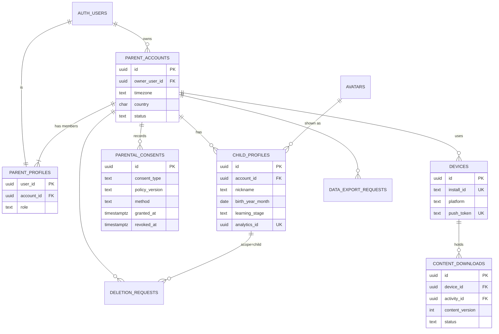
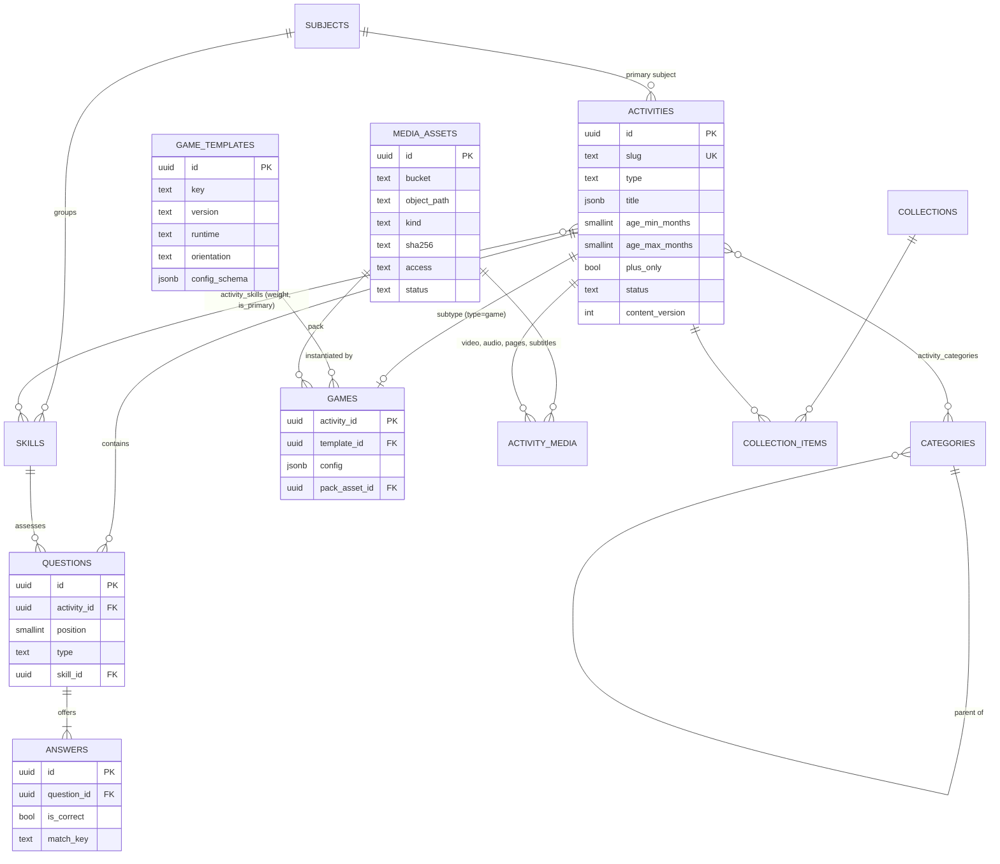
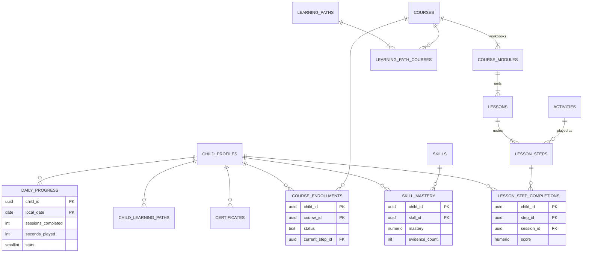
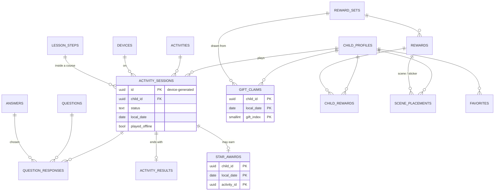
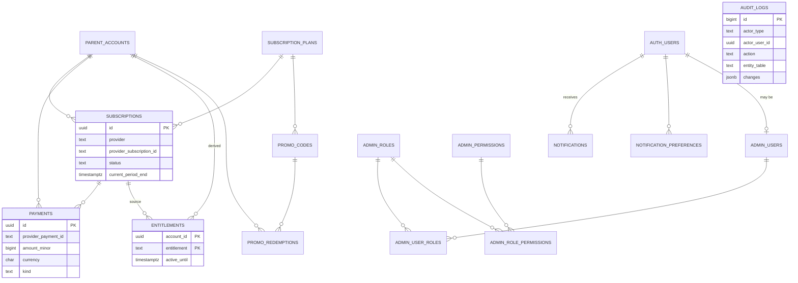

# 5. Database design

Full DDL: [`database/schema-draft.sql`](database/schema-draft.sql). **It is a draft, not a migration**, and has not been applied to any Supabase project. After approval it becomes `supabase/migrations/0001_init.sql`.

**Verified [V] on 2026-11-17** by loading it into a throwaway local Postgres 16 with a stub of Supabase's `auth` schema ([`database/supabase-auth-stub.sql`](database/supabase-auth-stub.sql)) and running [`database/schema-draft-checks.sql`](database/schema-draft-checks.sql):

| check | result |
| --- | --- |
| loads without errors | ✓ |
| tables in `public` | 64 (+ `analytics.events`, partitioned monthly) |
| RLS enabled | 64 / 64; 138 policies; no table without a policy |
| foreign keys | 118; **every FK column indexed** (re-run 2026-11-18 after the design review) |
| behaviour checks | 29 / 29 passed (listed in §5.7) |

Two bugs were found and fixed during that run: the publish guard ran as a `security definer` and so treated everyone as the service; and Supabase's default table grants would have left `audit_logs` writable by clients.

## 5.1 Requested entities → tables

| brief entity | table(s) | notes |
| --- | --- | --- |
| Parent accounts | `parent_accounts` | the household: timezone, country, locales, status |
| Parent profiles | `parent_profiles` | one row per signed-in adult (`auth.users`), role owner / co_parent |
| Child profiles | `child_profiles` | nickname, avatar, birth **year + month** only, stage, `analytics_id` |
| Categories | `categories` (tree), `activity_categories` | browsing themes (Animals, Space …) |
| Subjects | `subjects` | curriculum areas |
| Skills | `skills`, `activity_skills` | skill groups from the original's progress report [V R12] |
| Courses | `courses`, `course_modules` | the original's "Lessons" programmes and "workbooks" [V SS-07, SS-10] |
| Lessons | `lessons`, `lesson_steps` | the original's "units" and "nodes" (knowledge check, collect, trace …) [V SS-10] |
| Activities | `activities` (+ `activity_media`) | supertype of every playable / watchable item |
| Game templates | `game_templates` | the 12 engines, versioned, with orientation and config JSON Schema |
| Games | `games` | 1:1 subtype of a `game` activity: template + config + pack |
| Questions | `questions` | quizzes, knowledge checks, question-driven games |
| Answers | `answers` (authored options) + `question_responses` (what the child answered) | "answers" split into two meanings |
| Media assets | `media_assets` | registry of every file in Storage, with hash, size, access level |
| Activity sessions | `activity_sessions` | one attempt; **device-generated id = idempotency key** |
| Activity results | `activity_results` | 1:1 outcome of a finished session |
| Learning progress | `skill_mastery`, `lesson_step_completions`, `course_enrollments`, `daily_progress`, `certificates` | see `09-learning-progress-engine.md` |
| Rewards | `reward_sets`, `rewards` | stickers, scenes, badges, avatar items |
| Child rewards | `child_rewards`, `star_awards`, `gift_claims`, `scene_placements` | 5 stars = 1 gift [V R7, SS-01] |
| Learning paths | `learning_paths`, `learning_path_courses`, `child_learning_paths` | an ordered sequence of courses per stage |
| Subscriptions | `subscription_plans`, `subscriptions`, `entitlements`, `promo_codes`, `promo_redemptions` | |
| Payments | `payments`, `billing_webhook_events` | amounts in minor units + currency |
| Notifications | `notifications`, `notification_preferences`, `devices.push_token` | parents only |
| Downloaded content | `content_downloads` (+ `devices`) | which device holds which activity version |

**Added (needed by the brief's security section or the recon):** `parental_consents`, `data_export_requests`, `deletion_requests`, `audit_logs`, `admin_users`, `admin_roles`, `admin_permissions`, `admin_role_permissions`, `admin_user_roles`, `feature_flags`, `collections`, `collection_items`, `favorites`, `daily_free_allocations`, `screen_time_rules`, `screen_time_usage`, `avatars`, `devices`.

## 5.2 Entity relationship diagrams

Split by area for legibility. Columns shown are keys and the most important fields; the SQL has everything.

### Family, consent, devices

### Catalogue, games, questions, media

### Courses, paths, learning progress

### Play, results, rewards

### Billing, notifications, admin

## 5.3 Table catalogue

| group | tables (64) |
| --- | --- |
| admin & RBAC (5) | admin_users, admin_roles, admin_permissions, admin_role_permissions, admin_user_roles |
| family (6) | parent_accounts, parent_profiles, parental_consents, child_profiles, avatars, devices |
| media (1) | media_assets |
| catalogue (21) | categories, subjects, skills, game_templates, activities, activity_categories, activity_skills, activity_media, games, questions, answers, courses, course_modules, lessons, lesson_steps, learning_paths, learning_path_courses, collections, collection_items, reward_sets, rewards |
| play, progress, controls, offline (18) | activity_sessions, activity_results, question_responses, star_awards, gift_claims, child_rewards, scene_placements, course_enrollments, lesson_step_completions, skill_mastery, daily_progress, child_learning_paths, certificates, favorites, daily_free_allocations, screen_time_rules, screen_time_usage, content_downloads |
| billing (7) | subscription_plans, subscriptions, payments, entitlements, billing_webhook_events, promo_codes, promo_redemptions |
| notifications (2) | notifications, notification_preferences |
| privacy, audit, config (4) | data_export_requests, deletion_requests, audit_logs, feature_flags |
| analytics schema | analytics.events (partitioned by month) |

Total: 5 + 6 + 1 + 21 + 18 + 7 + 2 + 4 = **64**, matching the loaded database.

## 5.4 Integrity rules enforced by the database

| rule | how | source |
| --- | --- | --- |
| a replayed offline upload never double-counts | `activity_sessions.id` is generated on the device; `insert … on conflict (id) do nothing` | offline design |
| one star per distinct activity per child per household day | PK `star_awards (child_id, local_date, activity_id)` | [V R7] |
| a gift can't be claimed twice | PK `gift_claims (child_id, local_date, gift_index)` + engine check `5 × gift_index ≤ stars` | [V R7, SS-01] |
| each lesson step completes once (sequential unlock) | PK `lesson_step_completions (child_id, step_id)` | [V SS-10] |
| one certificate per course | unique `certificates (child_id, course_id)` | [V R8] |
| a `games` row can only extend a `game` activity | composite FK `(activity_id, 'game') → activities (id, type)` | normalisation |
| a scene placement uses a real scene and a real sticker | composite FKs to `rewards (id, type)` | |
| child birth date stored as month only | `check (extract(day from birth_year_month) = 1)` | data minimisation |
| Unity templates can't target web | check on `game_templates` | D5 |
| promo codes can't be over-redeemed | `check (redeemed_count <= max_redemptions)` + conditional update | [V R33] |
| webhooks processed once | unique `billing_webhook_events (provider, provider_event_id)` | |
| one row per store subscription | unique `subscriptions (provider, provider_subscription_id)` | |
| one row per provider payment | unique `payments (provider, provider_payment_id)` | |
| a session can't last more than 4 hours or end before it starts | checks on `activity_sessions` | clock-skew guard |
| Basic tier gets at most 10 activities a day | `check (cardinality(activity_ids) between 0 and 10)` | [V R21] |
| publishing needs `content.publish` | trigger `private.guard_publish` | RBAC |
| the audit log is append-only | trigger + revoked grants | security |

## 5.5 Indexing strategy

- Every FK column is indexed (verified: 0 unindexed of 118).
- Access-path indexes: `activity_sessions (child_id, local_date desc)` for reports and today's stars; `activities (status, type, age_min_months, age_max_months)` for feeds; `collections (surface, status, sort)`; `subscriptions (account_id, status)`; `notifications (status, scheduled_for) where status = 'queued'` (partial); `billing_webhook_events (received_at) where processed_at is null` (partial backlog index).
- Search: `activities.search_tsv` (GIN, `simple` config so short words like "abc" match) + trigram GIN on the English title. Per-locale search columns are added when a second content language ships [OPEN].
- `analytics.events` is partitioned by month; indexes on `(event_name, occurred_at)` and `(subject_id, occurred_at)`.

## 5.6 Access policies (summary; details in `06-…`)

| table group | anon | parent | admin (aal2 + permission) | service role |
| --- | --- | --- | --- | --- |
| published catalogue | read published | read published | read drafts (`content.read`); write (`content.write`); publish (`content.publish`) | all |
| gated media metadata | — | — (file access via signed URLs only) | read (`content.read`) | all |
| family + child data | — | **read own account / own children only** | read (`support.read`) | all (writes happen here) |
| billing | plans only | read own | read (`billing.read`), plans/promos (`billing.manage`) | all |
| notifications | — | read own | — | all |
| admin tables | — | — | `admin.manage` (no self-grant) | all |
| audit log | — | — | read (`audit.read`); nobody writes or edits | insert via trigger only |

**No client has insert, update or delete policies on family, child or billing tables.** Those writes happen only in Edge Functions after their checks (D2). A modified app can't award itself stars, unlock courses or grant itself Plus.

## 5.7 Behaviour checks that passed (29)

Integrity: game subtype on a video rejected; full birth date rejected; Unity-on-web rejected; badge-as-sticker rejected; a replayed session stored once; a second star for the same activity and day ignored; promo cap held at 1; household day computed in the account's timezone (21:30 UTC = next day in Dubai).
Parent A: sees only their own child, their own session, and published activities only; sees no audit rows; can't write sessions directly; updating another family's child touches 0 rows; can't write the audit log.
Anon: published activities only, no children, no gated media rows.
Admin: an editor without MFA can't write; with MFA can create a draft but can't publish; sees drafts; a publisher can publish; a publisher can't see children; a super admin can't grant themself a role; a super admin can read the audit log.
Audit: a child-profile change is logged as column names only; the publish is logged; the log can't be edited even by the table owner.
Deletion: deleting an account cascades its children, sessions and stars; the audit log survives.
Service role: can write a session for any child (as Edge Functions will, after checks).

## 5.8 Migrations and data changes

- Migrations: plain SQL in `supabase/migrations/`, generated and reviewed by hand, applied by CI (`supabase db push`) to staging, then production after approval. Never edited after release; only new migrations.
- Expand-and-contract for breaking changes (add column → backfill → switch clients → drop later), because old app versions stay in use for months.
- pgTAP tests in `supabase/tests/` run on every PR against a fresh local database (`supabase db reset` + `supabase test db`). The 29 checks above become the first test file.
- Seed data for dev only: avatars, subjects, skills, 12 template rows, a few sample activities. No real people.
