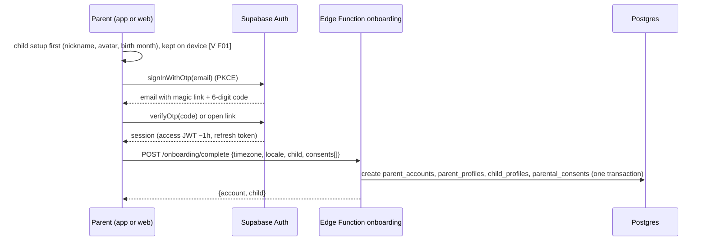

# 6. Authentication and authorization

## 6.1 Identities

| identity | authenticates with | stored as | can do |
| --- | --- | --- | --- |
| **Parent** (owner) | email magic link **plus a 6-digit code in the same email** [P]; optional password; Sign in with Apple; Google | `auth.users` + `parent_profiles (role=owner)` | everything for their household |
| Co-parent (later) | same | `parent_profiles (role=co_parent)` | read reports, manage children; not billing or deletion [P] |
| **Child** | **does not authenticate** [D8] | `child_profiles` row | plays on a device where a parent is signed in, in "kid mode" |
| **Admin** | email + password (or SSO [OPEN]) **+ TOTP MFA, required** | `auth.users` + `admin_users` + roles | what their permissions allow, only in an `aal2` session |
| Service | service-role key, server-side only | — | Edge Functions after their own checks |
| Job | shared secret header from Vault | — | job routes only |
| Webhook sender | provider signature (Stripe) / bearer secret (RevenueCat) | — | webhook routes only |

Why magic link + code: the original's main login is a magic link [V R16], and its classic failure is a link opened on another device. The same email carries a code that can be typed on the device that asked for it.

**Apple rule**: because Google sign-in is offered, Sign in with Apple must be offered on iOS [A: App Store guideline 4.8, general rule].

## 6.2 Flows

- **Sessions**: access JWT lifetime 1 hour; refresh-token rotation on; reuse detection on [P].
- **Token storage**: mobile → `flutter_secure_storage` (Keychain / Keystore); parent and admin web → httpOnly, Secure, SameSite=Lax cookies via `@supabase/ssr`; **children's web (Flutter web)** → browser storage (the Supabase default). That is weaker against XSS, so the kids web app has a strict CSP, no third-party scripts and no user-generated HTML. [P]
- **Email deliverability**: Resend as Supabase Auth's SMTP, own domain, SPF/DKIM/DMARC, branded templates. Login depends on it.
- **Re-authentication** (a fresh code) is required for: changing email, deleting a child or the account, requesting a data export, changing the password.
- **Account recovery**: email is the identity; there are no security questions.

## 6.3 Kid mode and the parental gate

- After sign-in on a device, the app runs in **kid mode**: the Kids Area for the selected child. The parent session stays on the device.
- The **parental gate** (design K20 [P]: "tap these numbers" with three digits written as words, new digits every time, 3 wrong tries → 30 s pause; replaces the original's birth-year keypad [V SS-17], which a child who knows a parent's age can pass) protects: the Parents Area, purchases, external links, permission prompts (mic/camera), sign-out, child switching settings. Required by store Kids-category rules.
- The gate is **not a security boundary**; a determined child could pass it. Real protection is server-side: purchases need a store confirmation, deletions need re-authentication, and reports are read-only.
- A passed gate issues an in-memory **gate token** valid for 5 minutes [P].
- Optional **parent PIN** per device (hashed, stored on the device in secure storage) for families who want more than the gate [P, should-have].

## 6.4 Authorization model

### Layers

1. **Gateway**: Supabase verifies the JWT on every Data API and Edge Function call (except webhook and job routes, which verify signatures and secrets).
2. **RLS**: every table; helpers in the `private` schema:
   - `private.is_account_member(account_id)`: the user has a `parent_profiles` row in that account;
   - `private.can_access_child(child_id)`: the child belongs to the user's account;
   - `private.has_permission(perm)`: the user is an active admin with a role granting `perm`, **and** the session is `aal2` (MFA verified);
   - `private.is_service()`: service role or migration context.
3. **Edge Function checks**: the same helpers called explicitly before any service-role write, plus business rules (Plus required, screen time left, child limit per plan).
4. **Database constraints**: last line of defence for integrity (`05-…` §5.4).

### Child-scoped requests

Every Edge Function call made for a child carries `X-Child-Id`. The function calls `private.can_access_child` with the user's JWT. If it fails, the result is `403` and an audit entry. The child id is never trusted from the request body alone.

### Parent capability matrix [P]

| action | owner | co_parent (later) | gate needed in app | re-auth |
| --- | --- | --- | --- | --- |
| play as a child, read feeds | ✓ | ✓ | — | — |
| view progress reports | ✓ | ✓ | ✓ | — |
| add / edit child | ✓ | ✓ | ✓ | — |
| delete child | ✓ | — | ✓ | ✓ |
| screen time, sections | ✓ | ✓ | ✓ | — |
| purchase / manage subscription | ✓ | — | ✓ | — |
| export data | ✓ | — | ✓ | ✓ |
| delete account | ✓ | — | ✓ | ✓ |

### Admin RBAC (seeded in the schema)

| role | permissions |
| --- | --- |
| content_editor | content.read, content.write |
| content_publisher | content.read, content.write, content.publish |
| support_agent | support.read, support.act, billing.read |
| finance | billing.read, billing.manage, support.read |
| privacy_officer | privacy.act, audit.read, support.read |
| super_admin | all (at most two people [P]) |

Rules:
- **MFA is enforced in the database**: a permission counts only when the JWT says `aal = aal2`. An admin session without MFA can read nothing extra (tested).
- **No self-grant**: an admin can't add roles to themself (tested).
- **Least privilege**: support staff see families read-only. They can't see children's play history unless the case needs it, and every support lookup is logged [P].
- **Admin web never holds the service-role key.** Privileged operations go through the `admin` Edge Function, which checks `has_permission` with the caller's JWT first.
- Admin sessions: 30-minute idle timeout in the admin middleware, 12-hour absolute limit [P].
- Admin accounts use company email addresses only (an allowlisted domain check in the `admin/users/invite` route) [P].

## 6.5 Webhook and job authentication

| caller | verification |
| --- | --- |
| Stripe | `Stripe-Signature` HMAC with the endpoint secret, 5-minute tolerance; event id dedupe |
| RevenueCat | `Authorization` bearer secret configured in RevenueCat; event id dedupe; **then re-fetch the subscriber from RevenueCat's REST API** before changing entitlements (never trust the payload alone) |
| video player → `media/hls/*` | a launch token in the query string (HMAC, bound to child + asset, expires with the signed segments); `verify_jwt = false` for this function only |
| pg_cron / queue → job routes | `X-Job-Secret` from Vault, compared in constant time; job routes reject the anon and user JWTs |

## 6.6 Threats specific to auth (more in `14-…`)

| threat | mitigation |
| --- | --- |
| magic-link phishing / account takeover | short link lifetime (1 hour max), single use, PKCE; code entry rate-limited; new-device sign-in email [P] |
| email enumeration | the same response whether the email exists or not |
| OTP brute force | Supabase Auth rate limits + our per-IP limit on the login page (Vercel firewall) |
| stolen refresh token | rotation with reuse detection; "sign out all devices" in settings |
| admin takeover | MFA enforced in RLS; company email only; audit of every admin write; quarterly access review |
| a child bypassing the gate to buy | store purchase sheets need the parent's store password or biometrics; web checkout needs the parent's session |
