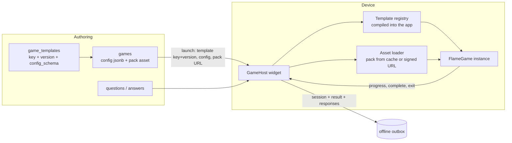

# 8. Game engine architecture

## 8.1 The idea

The original's public activity IDs follow `game_<mechanic>_<theme>` [V game-inventory.md]. Its games are **a small number of mechanics reused with different content**. We build the same way:

- **Game template** = one mechanic, written once in Flame (Dart), versioned. 12 for v1 (E1–E12).
- **Game** = an activity that points at a template version, plus a **config** (JSON, validated by the template's JSON Schema) and a **content pack** (art, audio, Rive and Lottie files).
- New games are mostly **content work in the admin web**, not engineering work.



## 8.2 Runtime packages

| package | contents |
| --- | --- |
| `kl_game_runtime` | `GameHost` (Flutter widget that hosts a Flame `GameWidget`), the `GameTemplate` contract, `GameContext` (config, locale, assets, audio, child-safe callbacks), asset loader (verifies sha256), audio service (voice-over per locale, music ducking), Rive and Lottie helpers, pause / resume / exit overlay, orientation lock, web audio unlock splash |
| `kl_game_templates` | E1–E12, one folder each: template class, config model (freezed), components, tests, a sample pack |
| `tools/template_playground` | a Flutter app (mobile + web) that loads any template with any config + pack. Used by engineers, content QA, and **embedded in the admin web for preview** |

### The template contract (illustration, not production code)

```dart
abstract class GameTemplate<C> {
  String get key;                         // 'drag_to_target'
  Set<SemVer> get supportedVersions;      // content made for 1.x runs on this build
  GameOrientation get orientation;        // landscape | portrait | any   [V SS-12]
  C parseConfig(Map<String, dynamic> json);   // throws on invalid config
  FlameGame build(GameContext<C> ctx);
}

class GameContext<C> {
  final C config;
  final AssetBundleView assets;           // read-only view of the verified pack
  final LocaleSpec locale;
  final AudioService audio;
  final List<QuestionDTO> questions;      // E6 quiz, knowledge checks
  final void Function(GameProgress) onProgress;
  final void Function(GameResult) onComplete;   // completed, score, correct/total, metrics
  final void Function() onExit;
  final Future<bool> Function(Permission) requestPermission; // goes through the parental gate
}
```

The host owns the session: it creates the `activity_sessions` id on start, records results and responses, writes them to the offline outbox, and lets the sync engine upload them. **Templates never touch the network, storage, purchases or links.** That keeps them safe and testable.

## 8.3 v1 templates (from the recon's 36 mechanics)

| id | template key | mechanics covered (recon) | runtime | orientation | config highlights |
| --- | --- | --- | --- | --- | --- |
| E1 | `drag_to_target` | stickers, sort, kitchen, dress-up, jigsaw (G03, G14, G15, G22, G24, G25) | Flame | landscape | items, targets, snap rules, rounds |
| E2 | `memory_match` | memory, pairs, matching (G01, G02, G17) | Flame | landscape | grid size, pairs (image / word / sound) |
| E3 | `trace_write` | letters, numbers, shapes tracing (G06, G07, G08) | Flame | landscape | glyph paths, stroke order, tolerance |
| E4 | `colour_draw` | colouring, free drawing (G04, G05) | Flame | landscape | line art, palette; **nothing the child draws leaves the device** |
| E5 | `find_hidden` | hidden objects, letter search (G16, G23, G27, G28) | Flame | landscape | scene, hotspots, prompts |
| E6 | `quiz` | choose the answer, knowledge checks (G09, G30, S19) | Flame + Flutter overlay | any | uses `questions` / `answers`; timed or untimed |
| E7 | `runner_catcher` | lane runner, catcher (G10, G11, G12, G21) | Flame | landscape | lanes, spawn table, speed curve |
| E8 | `shape_fit` | tangram, shape fit (G13) | Flame | landscape | pieces, silhouette, rotation allowed |
| E9 | `maze_path` | maze, path drawing (G18, G19) | Flame | landscape | grid / path, goal |
| E10 | `book_reader` | interactive books, audiobooks (G29) | Flutter widgets + Lottie | landscape | pages, narration audio, word timings, hotspots |
| E11 | `rhythm_pattern` | rhythm, patterns (G26) | Flame | landscape | BPM, pattern, input windows |
| E12 | `stacking` | stacking with physics (G20) | Flame + flame_forge2d | **portrait** [V SS-12] | pieces, rotate / drop controls |

Deferred: microphone and camera mechanics (G32, G33, G37) wait for a privacy review [P]. If they ship, recordings are processed on the device and never uploaded.

## 8.4 Rive, Lottie, audio

| tool | use | rule |
| --- | --- | --- |
| **Rive** | characters and mascots with state machines (idle, cheer, think, sad); interactive buttons in games; character pick [V SS-09] | one shared character rig per character; state-machine inputs named in a shared contract so templates can drive any character |
| **Lottie** | UI celebrations outside the game canvas: star burst, gift opening, confetti, loading | lightweight JSON; preloaded with the pack or the app |
| **Audio** | voice-over per locale, SFX, music | AAC (`.m4a`) for broad support [P]; loudness-normalised in the pipeline; music ducks under voice |

## 8.5 Content pack format

```
pack.zip
├── manifest.json   {template:"drag_to_target", templateVersion:"1.2.0", contentVersion:3,
│                    locales:["en","es"], files:[{path, sha256, bytes}], entry:"config.json"}
├── config.json     validated against game_templates.config_schema (admin + CI + runtime)
├── images/         WebP (texture atlases where many sprites)
├── audio/<locale>/ AAC
├── rive/           .riv
└── lottie/         .json
```

- Built by the content pipeline CLI, never by hand. Target ≤ 15 MB per pack (checked by the pipeline and by `admin/content/validate`).
- Stored in the private `content` bucket at `content/{activityId}/{contentVersion}/pack.zip` (`11-…`).
- The runtime verifies every file's sha256 before loading. A corrupt pack is deleted and downloaded again.

## 8.6 Versioning and compatibility

- Templates use semver. Minor versions add optional config fields; a major version means new content.
- Each app build registers the template versions it contains. `play/launch` checks `game_templates.min_app_build` against `X-App-Version`. Too old → `426 APP_TOO_OLD` with an "update the app" screen. Feeds hide activities this build can't play.
- An activity pins a template version. Republishing with a new content version invalidates cached packs (the version is in the path).

## 8.7 Performance budgets [P, measured in M2]

| metric | target |
| --- | --- |
| frame rate | 60 fps on mid-range devices; ≥ 30 fps on the floor device (Android 10, 4 GB RAM [V R19]) |
| time from tap to playable | ≤ 2 s with the pack cached; ≤ 6 s on 10 Mbps when downloading |
| memory | ≤ 250 MB while a game runs |
| pack size | ≤ 15 MB |
| web | the template's code is a deferred import; the first web load of the kids shell ≤ 3 MB (Flutter web engine included) [A: to measure] |

## 8.8 Testing

- Each template: unit tests for its rules (scoring, completion), `flame_test` component tests, golden screenshots of key states, and a **config fuzz test** that feeds random valid configs and asserts no crash.
- Every published pack: a CI job loads it headless in the playground and plays a scripted path to completion [P].
- Device matrix for M2 and before each release: iPad (oldest supported), iPhone, Android floor device, Android tablet, Chrome on a Chromebook, Safari on an iPad.

## 8.10 Unity (optional, later) [P, D5]

Only if a future mechanic truly needs 3D or advanced physics. It would be embedded on mobile through a Flutter–Unity bridge, marked `runtime = 'unity'` with `supported_platforms` limited to iOS and Android (the database rejects Unity on web), and shipped as a separate download if size allows. Not part of v1.

## 8.9 Child safety in games

- No links out, no ads, no chat, no user-to-user content.
- Permissions (mic, camera) only through `requestPermission`, which shows the parental gate first.
- Drawings (E4) and any future recordings stay on the device.
- No timers that pressure the child to keep playing; there's a natural end and a "play again" choice (UK Children's Code: no nudge techniques [A]).
