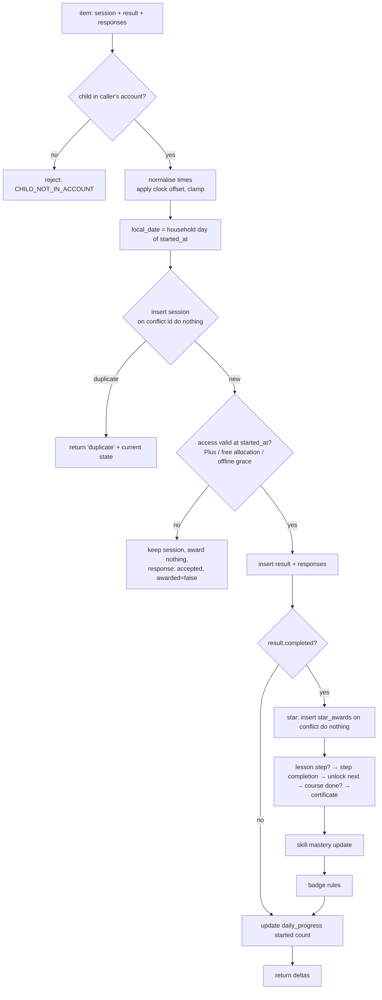

# 9. Learning progress engine

The engine turns raw play (sessions, results, answers) into what children and parents see: stars, gifts, unlocked steps, finished courses, certificates, skill progress and reports. **It runs on the server only** (`private.apply_session`, called by `POST /play/sync`), so it gives the same answer for online and offline play and can't be gamed by a modified app.

## 9.1 Inputs and outputs

| in | out |
| --- | --- |
| `activity_sessions`, `activity_results`, `question_responses` (from the device) | `star_awards`, `daily_progress`, `lesson_step_completions`, `course_enrollments`, `certificates`, `skill_mastery`, `child_rewards` (badges), `child_learning_paths`, notifications |

## 9.2 `apply_session`: one transaction per uploaded item



Rules in detail:

1. **Time.** The device sends `started_at` / `ended_at` from its clock plus the `clockOffsetMs` it measured at the last sync (server time minus device time). The server corrects by the offset and then clamps: no future times (more than 5 minutes ahead), nothing older than 30 days, and the table's 4-hour maximum. **The household day** comes from `parent_accounts.timezone`, never from the device, so changing the device clock can't mint extra stars [P].
2. **Idempotency.** The session id is generated on the device. A replay returns `duplicate` and the current state, and changes nothing.
3. **Access at play time.** Sessions played offline are judged against the entitlement that was valid when they started (the offline entitlement token, `12-…`). An activity the child was not allowed to play still counts as played (honest history), but earns no star or unlock.
4. **Stars.** One star per **distinct** activity per child per household day [V R7]. The primary key enforces it. A completed session earns a star; an abandoned one doesn't.
5. **Gifts.** `giftsAvailable = floor(starsToday / 5) − giftsClaimedToday` [V R7, SS-01: 5 slots + gift]. Claiming draws stickers from an active reward set (`gift_claims` PK prevents double claims).
6. **Lesson steps (sequential unlock [V SS-10]).** When the session came from a lesson step and is completed:
   - insert `lesson_step_completions` (first completion only);
   - move `course_enrollments.current_step_id` to the next step by (module, lesson, step) position;
   - when every `required` step of the course is complete → status `completed`, insert `certificates`, queue a "certificate earned" notification for the parents.
   - Knowledge checks [V SS-10] always count as complete once answered (they measure, they don't block). Their score is stored for the pre/post comparison.
7. **Skill mastery** (below).
8. **Badges.** `rewards.unlock_rule` names a rule (e.g. `first_course`, `streak_7_days`, `stars_100`). Rules are small SQL predicates in the engine; a badge is granted once.
9. **Daily roll-up.** `daily_progress` counts started / completed sessions, seconds played and stars, so reports never scan raw sessions for common views.

The response carries **deltas** (stars today, gifts available, newly unlocked steps, certificates, badges). The app reconciles its optimistic UI with them.

## 9.3 Skill mastery model (v1) [P]

Simple, explainable, and cheap to compute:

```
evidence e ∈ [0,1]:
  scored activity (quiz, knowledge check): e = correct / total     (per question skill when questions carry skill_id)
  completed unscored activity:             e = 0.7
  abandoned:                               no update
weight w = activity_skills.weight (0..1); the question skill gets w = 1
learning rate α = max(0.1, 1 / (n + 2))      n = evidence_count so far
same activity again on the same day:         α × 0.5   (repetition counts, but less)

mastery ← mastery + α · w · (e − mastery)
evidence_count ← n + 1
```

- Bands shown to parents: **Getting started** (< 0.4), **Practising** (0.4–0.75), **Confident** (> 0.75) [P]. No percentages for children.
- The child's **garden** (design K18, `GET /learning/journey`) uses the same bands per skill group: the group's level is the median band of its practised skills, drawn as 0 (seed, nothing practised) to 3 (flower = Confident). A plant never shrinks in front of the child: the garden shows the highest level reached in the last 30 days [P].
- Upgrade path: replace with Bayesian Knowledge Tracing or an Elo-style item-difficulty model once there is enough data. The table shape stays the same.
- Mastery is a **learning aid, not a grade**. It is not shared with anyone outside the family. It is "profiling" in GDPR terms, so it's covered in the DPIA [OPEN, `14-…`].

## 9.4 Recommendations ("up next") [P]

Rule-based in v1, in this order:
1. Continue the child's current course step.
2. The next course in the child's learning path for their stage.
3. One practice activity for the weakest skill below 0.4 that was practised in the last 14 days.
4. Fill the rest from published collections for the child's age band, excluding what was played today.

The stage comes from `birth_year_month` (age in months → toddler / preschool / kindergarten / grade 1 / grade 2) unless the parent set it.

## 9.5 Basic (free) allocation

Each day a Basic child gets up to 10 activities [V R21], picked when they first open the app that household day, then fixed (`daily_free_allocations`). Selection: free-eligible, age-matched, not played in the last 3 days, mixed across subjects. Plus children skip this table.

## 9.6 Parent progress report (`GET /progress/report`)

| block | source | recon |
| --- | --- | --- |
| activities completed in the window | `daily_progress` | [V SS-14] |
| top skill and top activity | `activity_sessions` ⨝ `activity_skills` | [V R12] |
| top 3 subjects | sessions ⨝ activities.subject_id | [V R12] |
| skills by group (movement, language, literacy & numeracy, thinking, social life) | `skill_mastery` ⨝ `skills.skill_group` | [V R12] |
| course pre/post | first vs latest knowledge-check score per course | [V R8, U15 partly] |
| daily chart | `daily_progress` | [P] |

The default window is **14 days** [V SS-14], selectable 7–90. A loading skeleton and an empty state ("no activities yet") match the original's skeleton [V SS-14].

## 9.7 Correctness and recovery

- **Re-derivable**: everything the engine writes can be rebuilt from `activity_sessions` + `activity_results` + `question_responses` with a `private.rebuild_child_progress(child_id)` function [P]. That covers bug fixes and rule changes.
- **Tests**: pgTAP tests per rule (star once per day across the timezone boundary, gift math, unlock order, certificate once, mastery bounds, replay idempotency, offline grace).
- **Performance**: one call handles ≤ 100 items; each item is a few indexed writes. The target is p95 < 300 ms for a 20-item batch [P].
