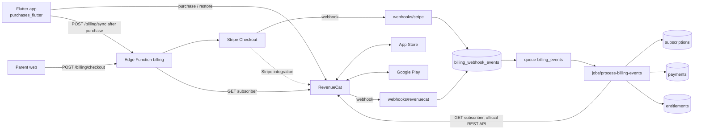

# 10. Subscription and payment architecture

## 10.1 Product model

| tier | what | source |
| --- | --- | --- |
| **Basic** (free) | 1 child profile; up to 10 activities a day from a daily allocation; no favorites, no downloads | [V R21] |
| **Plus** | full catalogue, courses, downloads, favorites, up to 4 children (`subscription_plans.max_children`) | [V R21, R24] |
| plans | `plus_monthly`, `plus_annual` (lifetime optional later) with a 7-day trial [A U16] | prices set per store and per Stripe country [OPEN] |

The entitlement key is `plus`. Every check in the system asks one question: **does this account have `entitlements.active_until > now()`?**

## 10.2 Channels and rules

| where the parent pays | provider | why |
| --- | --- | --- |
| iOS / iPadOS app | Apple In-App Purchase (StoreKit 2) via RevenueCat | digital subscriptions sold inside the app must use IAP [A, store rule] |
| Android app | Google Play Billing via RevenueCat | same [A] |
| parent web dashboard | Stripe Checkout + Billing (cards, wallets; PayPal where Stripe supports it) | the original does the same [V R25] |
| promo / gift codes | our own `promo_codes` → a `promo` subscription | [V R33] |

- **No links from the apps to web checkout** in v1 [P]. Store rules on external purchase links differ by country and keep changing, and Kids-category apps are held to a stricter standard. Revisit per market later.
- The **children's web app (Flutter web)** has no purchase flow. "Get Plus" opens the parent web dashboard after the gate.
- **Purchases always sit behind the parental gate** in the apps [V R20, SS-17].

## 10.3 Components



- **RevenueCat** [P, D3]: validates Apple and Google receipts server-side, follows renewals, grace periods, billing retry, refunds and family sharing, and also tracks Stripe subscriptions through its Stripe integration. The RevenueCat `app_user_id` is our **`parent_accounts.id`**, so all of a household's devices share one entitlement.
- **Our database is the source of truth for access.** RevenueCat is the source of truth for store state. We copy store state into `subscriptions` and `payments` and derive `entitlements`.

## 10.4 Secure payment verification

| rule | how |
| --- | --- |
| never trust the client | the app's "purchase succeeded" only triggers `POST /billing/sync`; the server fetches the subscriber from RevenueCat's REST API with our secret key and decides |
| never trust a webhook payload alone | verify the signature or secret, store it raw (unique event id), then **re-fetch** the subscriber or Stripe object before changing anything |
| replay-safe | `billing_webhook_events (provider, provider_event_id)` unique; `subscriptions (provider, provider_subscription_id)` unique; `payments (provider, provider_payment_id)` unique; every handler is an upsert |
| order-independent | webhooks arrive out of order; the job applies the **fetched current state**, not the event's delta |
| environment separation | sandbox purchases are stored with `environment = 'sandbox'` and never grant production access |
| reconciliation | daily job re-checks subscriptions whose period ends within ±48 h; alerts on drift |
| secrets | RevenueCat secret key, Stripe secret + webhook secret only in Edge Function secrets |
| audit | every change to `subscriptions`, `entitlements`, `payments`, `promo_codes` is audited by trigger |

## 10.5 Entitlement derivation

```
active_until = max(current_period_end) over the account's subscriptions where
               status in ('trialing','active','grace_period')
               and environment = 'production'
               (promo subscriptions included)
entitled     = active_until > now()
```

- **Grace period** (store billing retry with access): entitled. **Billing retry without grace**: not entitled; the parent is notified.
- **Refund or revoke**: status `refunded` / `revoked`; entitlement recomputed at once; a negative `payments` row is written.
- **Plan downgrade with more children than allowed**: no child is deleted; the extra profiles become read-only until the parent picks which to keep [P].
- **Offline**: the app holds a signed entitlement token (`12-…`) valid until `min(active_until, now + 7 days)`.

## 10.6 Payments table

`payments` mirrors money movement for support, finance reports and refunds:
- Apple / Google: from RevenueCat events (transaction id, price in purchased currency, currency, store) → `kind` initial / renewal / refund.
- Stripe: from `invoice.paid` / `charge.refunded` / disputes → `kind` initial / renewal / refund / chargeback.
- Amounts in **minor units** (`amount_minor bigint`) with an ISO 4217 `currency`. Refunds are negative. Taxes and store commission are not stored [P]; the stores' and Stripe's reports are the accounting record.

## 10.7 Lifecycle notifications to parents

| event | channel |
| --- | --- |
| trial ends in 2 days | email + push (if opted in) |
| billing issue | email |
| subscription cancelled / expired | email |
| promo time ending | email |

## 10.8 Account deletion and subscriptions

- **Stripe**: the deletion job cancels the subscription and deletes the customer.
- **Apple**: a server can't cancel an Apple subscription. The parent is told before confirming deletion and shown how to cancel in iOS settings (the original warns too [V R30]).
- **Google**: the job can revoke the subscription through the Play Developer API [A: verify policy at M8]. Default: tell the parent, like Apple.
- **RevenueCat**: the subscriber record is deleted through its API.

## 10.9 Testing

- Apple sandbox and StoreKit configuration files for local tests; Google Play license testers; Stripe test mode with test clocks for renewals and trial ends.
- Contract tests for webhook handlers using recorded sample payloads from the providers' docs.
- An end-to-end test per channel in staging: purchase → entitlement → refund → access removed.

## 10.10 Alternative without RevenueCat [P, D3 alternative]

Use the App Store Server API + App Store Server Notifications v2, the Google Play Developer API + Real-time Developer Notifications (Pub/Sub), and Stripe directly. Same tables, same derivation; it costs about 3–4 extra weeks to build plus ongoing upkeep, and saves RevenueCat's fee.
