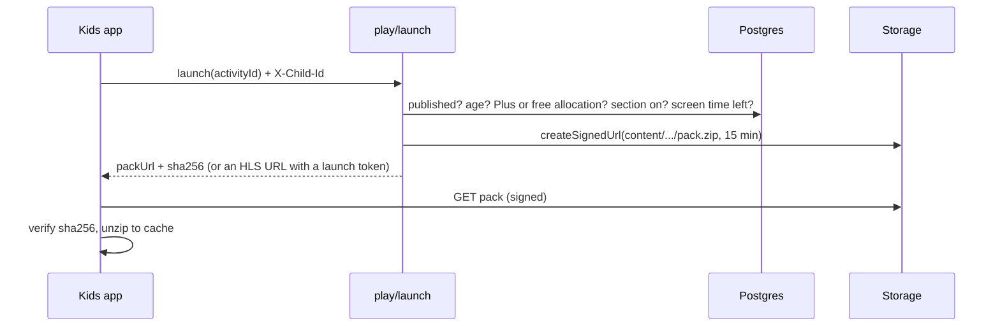

# 11. Media storage architecture

## 11.1 Buckets (Supabase Storage) [D Storage, P layout]

| bucket | public? | holds | who writes | who reads |
| --- | --- | --- | --- | --- |
| `public-assets` | **public** (CDN) | thumbnails of published items, avatars, UI art, category icons, sticker art | content pipeline / admin finalize | anyone (no secrets here) |
| `content` | private | game packs, story pages and narration, songs and podcasts audio, printable PDFs | content pipeline / admin finalize | **signed URLs only**, issued by `play/launch` and `library/downloads/manifest` |
| `video` | private | HLS renditions (`.m3u8` + segments), MP4 renditions for offline download, subtitles | content pipeline | signed URLs inside playlists from `media/hls/*`; signed MP4 URLs from the downloads manifest |
| `exports` | private | data export zips | `jobs/exports` | the account owner, through a signed link valid 7 days |
| `admin-staging` | private | raw uploads before validation | admins via signed resumable upload | `admin/media/finalize` only |

`media_assets` registers everything in `public-assets`, `content` and `video` with its kind, size, **sha256**, locale and status. The database enforces that the public bucket holds only `access = 'public'` rows.

## 11.2 Path conventions

```
public-assets/thumbs/{activityId}/{contentVersion}/{size}.webp      sizes: 256, 512, 1024
public-assets/avatars/{key}.webp
content/{activityId}/{contentVersion}/pack.zip
content/{activityId}/{contentVersion}/pages/{n}.webp | audio/{locale}/{n}.m4a
video/{assetId}/hls/master.m3u8
video/{assetId}/hls/{rendition}/index.m3u8 + seg_{00001}.ts|.m4s
video/{assetId}/mp4/{rendition}.mp4                                    offline download
video/{assetId}/subs/{locale}.vtt
exports/{accountId}/{requestId}.zip
```

Paths are versioned (`contentVersion`), so a CDN or device never serves stale content after a republish.

## 11.3 Protected media access



| asset type | access method | lifetime |
| --- | --- | --- |
| game pack, story pages, audio | signed URL per file or pack | 15 minutes [P] |
| HLS video | `media/hls/:assetId/master.m3u8?t=<launch token>` returns playlists whose segment URLs are signed | ~ video length + 1 h (VOD players don't refresh playlists) [P] |
| MP4 for offline | signed URL in the downloads manifest | 15 minutes to start; the download resumes with a fresh manifest |
| exports | signed URL | 7 days, then the file is deleted |
| public assets | plain CDN URL | cached long (immutable paths) |

**Storage RLS** on `storage.objects` [P]:
- `public-assets`: read for everyone; no client writes.
- `content`, `video`, `exports`: **no client policies at all**. Only the service role (Edge Functions, the pipeline) reads and writes, and clients get signed URLs.
- `admin-staging`: insert only for `has_permission('content.write')`, into a path prefixed with the uploader's id; no reads.

**Accepted risk**: a signed URL can be shared until it expires, and downloaded packs can be copied off a rooted device. That is acceptable for children's learning content and is the same trade-off the original makes for offline downloads [A].

## 11.4 Content pipeline (outside Supabase) [P, D6]

Edge Functions can't run ffmpeg or long jobs, so media processing is a **CLI** (`content/cli`) that runs in GitHub Actions (or on a content producer's machine):

1. **Ingest** source files from the content repo or from `admin-staging`.
2. **Validate**: real file type (magic bytes, not the extension), dimensions, durations, loudness, file size caps.
3. **Transcode**:
   - video → HLS (3 renditions: 360p, 540p, 720p, 6 s segments) + one MP4 rendition (540p) for offline;
   - audio → AAC `.m4a`, loudness-normalised;
   - images → WebP thumbnails at 256 / 512 / 1024.
4. **Pack** game and story content into `pack.zip` with `manifest.json` and sha256 per file (`08-…` §8.5).
5. **Upload** with the service key to the target bucket and path; **register** through `admin/media/finalize` (sets `media_assets` to `ready`).
6. **Report** in the admin web: status per asset, errors.

The admin web's simple uploads (an image, a short audio clip) go through `admin/media/upload-url` (resumable TUS upload into `admin-staging`) → `admin/media/finalize`, which validates and moves small files without the CLI.

## 11.5 Cost and capacity risks [A, verify pricing at M0]

- Supabase Storage bills **egress beyond the plan quota per GB**. Video is the large item: 10,000 monthly active children watching 1 GB a month is about 10 TB of egress a month. Estimate this before launch.
- Mitigations, in order: (1) cap rendition bitrates for young children's content (simple animation compresses well); (2) put a CDN with cheap or zero egress in front of the `video` bucket; (3) move video only to Mux or to Cloudflare R2 + Stream. The `media_assets` registry and the `media/hls` route hide the storage location from apps, so this switch doesn't change app code.
- Offline downloads multiply storage reads. Downloads need Plus, and manifests are rate-limited.

## 11.6 Images in apps

- Flutter: `cached_network_image` with disk cache; thumbnails at the size needed (256/512/1024).
- Next.js: `next/image` with the Supabase public URL as a remote pattern; sizes pre-generated, so no runtime image transformation is needed [P].

## 11.7 Children's privacy in media

- No user-generated media is uploaded in v1. Drawings and any future recordings stay on the device.
- Avatars are picked from our library, never photos.
- Media files carry no personal data; EXIF is stripped by the pipeline.
