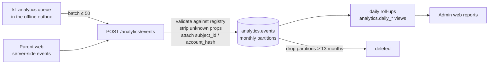

# 13. Analytics architecture

## 13.1 Principles [P, D7]

1. **No third-party analytics, attribution or advertising SDKs in any surface a child uses**: the Flutter app (mobile and web). This follows from COPPA, Apple's Kids Category rules and Google Play's Families policy [A: general store rules].
2. **First-party only.** Events go to our own Postgres (`analytics.events`), in our region, under our retention rules.
3. **Pseudonymous.** Kids' events carry `child_profiles.analytics_id`, a random id with no meaning outside our database. They never carry a user id, email, nickname, IP address or device advertising id. **Deleting the child deletes the link**, which anonymises their events at once.
4. **Learning analytics come from the learning tables** (`activity_sessions`, `activity_results`, `question_responses`), not from events. Events cover product usage that those tables don't already record.
5. **Allow-listed events.** The ingest route rejects any event name or property that isn't in the registry.

## 13.2 Three kinds of data

| kind | source | used for | who sees it |
| --- | --- | --- | --- |
| **learning data** | sessions, results, responses, mastery | parent reports, recommendations, content quality (which questions are too hard) | parents (own child); staff in aggregate only |
| **product events** | `analytics.events` | funnels (onboarding, paywall), feature use, performance (load times, sync failures) | staff in aggregate |
| **operational telemetry** | Sentry (scrubbed), Supabase logs | errors, crashes, latency | engineers |

## 13.3 Event pipeline

- Events queue offline in the same outbox as play data and are sent in batches.
- `account_hash` (parent surfaces) = HMAC-SHA256 of the account id with a secret salt that rotates yearly [P]. That allows funnels within a year without storing ids.
- Server-side events (`subscription.started`, `export.requested`) are written by Edge Functions directly.
- Retention: **13 months** of raw events, then the partition is dropped. Roll-ups contain counts only.

## 13.4 Event registry (v1) [P]

| event | surface | props (allow-listed) |
| --- | --- | --- |
| `app.opened` | kids, parent_app | `cold_start_ms`, `offline` |
| `onboarding.step_completed` | kids, parent_web | `step` |
| `onboarding.completed` | kids, parent_web | `method` (email / apple / google) |
| `feed.row_viewed` | kids | `surface`, `collection_id` |
| `activity.launch_failed` | kids | `activity_id`, `code` |
| `activity.load_time` | kids | `activity_id`, `ms`, `from_cache` |
| `paywall.viewed` | kids, parent_app, parent_web | `trigger` |
| `paywall.purchase_started` | parent_app, parent_web | `plan_key` |
| `gate.failed` | kids | — |
| `download.completed` / `download.failed` | kids | `activity_id`, `bytes`, `code` |
| `sync.completed` | kids | `items`, `rejected`, `ms` |
| `report.viewed` | parent_app, parent_web | `days` |
| `subscription.started` / `subscription.ended` | server | `provider`, `plan_key` |

**Never allowed:** free text, nicknames, birth dates, precise location, device identifiers, screenshots, recordings.

## 13.5 Reports in the admin web

| report | source |
| --- | --- |
| DAU / WAU / MAU of children (by `subject_id`), sessions per child per day | `analytics.events`, `daily_progress` (aggregate) |
| onboarding funnel; paywall → trial → paid conversion | events + `subscriptions` |
| content performance: plays, completion rate, avg duration, question difficulty (% correct), drop-off step in courses | learning tables (aggregate) |
| reliability: launch failures, load times p50/p95, sync rejections, download failures | events |
| revenue: active subscriptions by plan and channel, churn, refunds | `subscriptions`, `payments` |

Aggregates shown to staff are never broken down far enough to single out one child (minimum group size 10 [P]).

## 13.6 Parent web marketing pages [OPEN]

The public marketing pages (not the dashboard) may use a cookie-less, privacy-first analytics tool for page views. That needs a decision. It is never loaded on dashboard pages or anywhere in the children's app.

## 13.7 Crash reporting

Sentry (Flutter, Next.js, Edge Functions) with: `sendDefaultPii = false`, no user ids on kids surfaces, request bodies stripped, breadcrumbs limited to navigation route names, IP address collection off, EU data region if available [A]. Whether a crash reporter is acceptable in a Kids-category app has to be confirmed against current store rules. The fallback is self-hosted Sentry or crash logs uploaded to our own Edge Function [OPEN].
