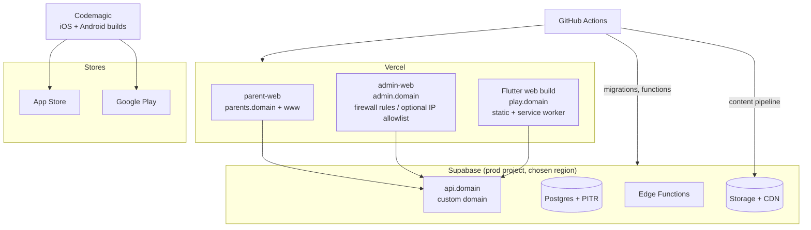

# 15. Deployment architecture

## 15.1 Environments [P]

| env | Supabase | web apps | mobile | data |
| --- | --- | --- | --- | --- |
| **local** | Supabase CLI (Docker): Postgres, Auth, Storage, Edge Functions | `pnpm dev` | simulators / emulators, `main_dev.dart` | seed data only |
| **preview** | Supabase branching per PR (database + functions) [P] | Vercel preview deployments | — | seed data |
| **staging** | dedicated project | `staging-parents.`, `staging-admin.`, `staging-play.` | TestFlight internal, Play internal testing, `main_staging.dart` | synthetic; store sandboxes; Stripe test mode |
| **production** | dedicated project, **region decided at M0** [OPEN], PITR backups on | `parents.`, `admin.`, `play.`, `www.` | App Store, Google Play, `main_prod.dart` | real |

Each environment has its own keys, webhook secrets, RevenueCat project and Stripe mode. Nothing is shared between staging and production.

## 15.2 Topology

| domain | serves |
| --- | --- |
| `www.<domain>` | marketing pages (parent-web, static) |
| `parents.<domain>` | parent dashboard |
| `admin.<domain>` | admin dashboard (noindex, strict CSP) |
| `play.<domain>` | children's web app (Flutter web) |
| `api.<domain>` | Supabase custom domain (Auth, Data API, Functions, Storage) |
| `links.<domain>` [P] | Universal Links / App Links host (`apple-app-site-association`, `assetlinks.json`) and magic-link landing |

## 15.3 CI/CD pipelines (GitHub Actions) [P]

| pipeline | trigger | steps |
| --- | --- | --- |
| **db** | PR touching `supabase/` | `supabase start` → `db reset` → `test db` (pgTAP, incl. RLS isolation) → lint SQL → generate types (fail if not committed) |
| **functions** | PR touching `supabase/functions/` | `deno fmt/lint/check` → unit tests → contract tests (webhook fixtures) |
| **flutter** | PR touching `apps/kids_app` or `packages/dart` | `melos bootstrap` → analyze → test (unit, widget, golden) → build web (size budget check) |
| **web** | PR touching `apps/*-web` or `packages/ts` | typecheck → lint → test → `next build` → Vercel preview |
| **deploy staging** | merge to `main` | migrations → functions → web apps → Flutter web → Codemagic staging builds |
| **deploy production** | release tag + manual approval | migrations (expand only) → functions → web apps → Flutter web; mobile via Codemagic to the stores |
| **content** | content repo change or manual dispatch | pipeline CLI: validate → transcode → pack → upload → register (`11-…` §11.4) |

**Order of a production release:** database migration (backward compatible) → Edge Functions (accept old and new clients) → web apps → mobile store releases (staged). Old app versions stay supported until they are below `minSupportedBuild`.

## 15.4 Mobile release

- Flavors: dev / staging / prod (bundle ids `…dev`, `…staging`, prod).
- Codemagic [P] builds iOS and Android with signing from its secure store, uploads symbols to Sentry, and publishes to TestFlight / Play internal testing, then promotes.
- Staged rollout on Google Play (10 % → 50 % → 100 %) and phased release on the App Store.
- **Forced update**: `GET /account/me` returns `minSupportedBuild`; below it the app shows an update screen (the offline outbox is kept and syncs after the update).
- Store listing requirements: Kids Category (Apple) / Designed for Families (Google), privacy nutrition labels and the data safety form filled from §14.3, in-app account deletion (present) [A].

## 15.5 Flutter web hosting

- Built with `flutter build web --release` (renderer chosen in M2), deployed as static files to Vercel.
- Cache: hashed assets immutable for 1 year; `index.html`, `flutter_bootstrap.js` and the service worker with no-cache.
- CSP without third-party script origins; `connect-src` limited to `api.<domain>`.

## 15.6 Configuration and secrets

| secret / config | lives in |
| --- | --- |
| Supabase anon (publishable) key, API URL | app flavors, Vercel env (public) |
| Supabase service-role key | Edge Function runtime (automatic) and GitHub Actions for the content pipeline only |
| Stripe secret + webhook secret, RevenueCat secret + webhook secret, Resend key, FCM credentials, entitlement signing key, job secret | Supabase Edge Function secrets / Vault |
| store signing keys | Codemagic secure storage |
| feature flags | `feature_flags` table (admin web) |

## 15.7 Backups, recovery, availability [P]

| item | target |
| --- | --- |
| database backups | point-in-time recovery enabled in production |
| RPO / RTO | ≤ 15 min / ≤ 4 h |
| storage | content is reproducible from the content repo + pipeline (source files kept in the content repo / an archive bucket) |
| restore drill | once before launch, then every 6 months: restore PITR into a scratch project and run the pgTAP suite |
| uptime target | 99.5 % for the API (the kids app keeps working offline during outages) |

## 15.8 Monitoring and runbooks

- Dashboards: API 5xx and latency, Edge Function errors, queue depth and dead letters, webhook lag, sync rejections, launch failures, store review status.
- Alerts to on-call (email / chat) for the thresholds in `04-…` §4.7.
- Runbooks: key rotation, webhook backlog, failed migration rollback (forward-fix policy), a store outage, a privacy incident.
