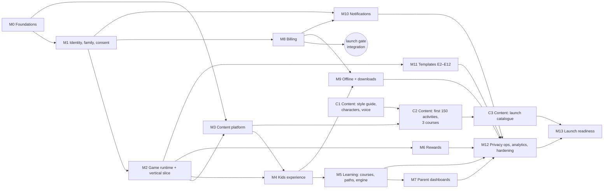

# 16. Development roadmap

**Nothing here starts until you approve the reconnaissance and this architecture.**

Development is split into **14 modules (M0–M13)**. Each is independently testable, has explicit dependencies, and is "done" only when its acceptance criteria pass in staging. Content production runs as a parallel track (C1–C3) because it, not engineering, is the critical path [V recon sizing].

## 16.1 Dependency graph

## 16.2 Modules

### M0 Foundations
- **Delivers:** the monorepo (§1.4), CI pipelines (`15-…` §15.3), Supabase local + staging projects, `0001_init.sql` from the approved draft, the pgTAP suite (the 29 draft checks + more), Edge Function skeleton with `_shared` (auth, errors, validation, rate limit), Flutter app skeleton with flavors and `kl_*` packages, both Next.js app skeletons, Sentry, Resend domain, design tokens placeholder.
- **Depends on:** approval; decisions D1–D9; data region.
- **Acceptance:** CI green on an empty feature; `supabase db reset && supabase test db` passes; the Flutter app builds for Android, iOS and web; both web apps deploy to staging automatically from `main`; no secrets in the repo (secret scan passes).

### M1 Identity, family and consent
- **Delivers:** S01–S06, S43 (sign-up, sign-in, OTP, Apple, Google, password reset), onboarding transaction, child profiles (add / edit / delete), avatars, profile drawer S26 [V SS-15], parental gate S28 [V SS-17], consent capture, devices, `account/me`.
- **Depends on:** M0.
- **Acceptance:** a new parent completes F01 on iOS, Android and parent web in ≤ the original's tap count [V user-flows F01]; no child data reaches the server before consent rows exist (test); parent A can't read or change parent B's child through the Data API or any function (pgTAP + API test); a magic link opened on another device can be finished with the code; Sign in with Apple works on iOS; deleting a child removes all its rows.

### M2 Game runtime + vertical slice
- **Delivers:** `kl_game_runtime`, template **E1 drag_to_target**, the template playground, `play/launch`, `play/sync` with the core engine (session, result, star, daily progress), the kids shell (Play tab, one seeded row), offline outbox (basic), parent "today" view.
- **Depends on:** M1.
- **Acceptance:** the same E1 activity plays to completion on an iPad, the floor Android device (Android 10, 4 GB), Chrome on a Chromebook and Safari on an iPad; ≥ 30 fps on the floor device, ≥ 55 fps on the iPad; tap-to-playable ≤ 2 s cached; one star appears and the parent sees it; replaying the same upload creates no second session or star; the Flutter web first load is measured and a renderer is chosen.

### M3 Content platform
- **Design gate:** admin screens A01–A13 have approved wireframes (`docs/design/screen-specs.md` §3); the admin uses the shared web components, no bespoke visual design.
- **Delivers:** admin web (auth + MFA, RBAC-filtered nav), activities / games / questions editor with JSON-Schema forms and live preview, taxonomy, collections with schedules, media library, resumable upload + finalize, publish validation, publish queue; the content pipeline CLI (video HLS + MP4, audio, images, packs); audit viewer.
- **Depends on:** M0, M2 (preview uses the playground).
- **Acceptance:** an editor without MFA can't change anything; an editor can create but not publish; a publisher publishes after validation passes; a video uploaded through the pipeline plays via `media/hls` with signed segments; a pack with a wrong sha256 is rejected; every admin write appears in the audit log.

### M4 Kids experience
- **Delivers:** the kids rail shell (Home / Learn / Watch / Listen / Me, design K07) in landscape and portrait, `catalog/home`, collections S11, search S10 (all types), Together row and Learn Together entry, Theater S14/S15 with skill chips and up-next [V SS-04, 06, 08], audio S16, story reader E10 S44, favorites S22, shuffle, launch-gate integration with entitlements and the free allocation, screen-time heartbeat and the time's-up screen S30.
- **Depends on:** M2, M3 (and M8 for the Plus gate; until then the gate uses a staging flag).
- **Acceptance:** each S-screen above matches its recon inventory entry, including loading, empty and error states; a Basic child gets exactly 10 activities that day and a lock + upsell on the rest; a disabled section disappears; screen time locks limited sections at the limit across two devices; search finds games, videos, songs and stories for "abc"; every screen in `docs/design/states.md` shows its loading, empty, error and offline state; the accessibility checks in `docs/design/accessibility.md` §6 pass.

### M5 Learning: courses, paths, progress engine
- **Delivers:** S17–S20, S46 course list, course tree with sequential unlock and progress bar [V SS-07, SS-10], knowledge checks (E6 quiz), certificates (+ PDF), learning paths, skill mastery, `learning/next`, the full `apply_session` engine, `rebuild_child_progress`.
- **Depends on:** M4.
- **Acceptance:** steps unlock in order; a step completes once; finishing all required steps issues one certificate and notifies the parent; knowledge-check scores are kept for pre/post; mastery stays in [0, 1]; a rebuild from raw sessions gives identical progress tables; engine p95 < 300 ms for 20 items.

### M6 Rewards
- **Delivers:** the 5-star widget [V SS-01], gift opening, sticker album S24, scene book S25, badges.
- **Depends on:** M2.
- **Acceptance:** 5 distinct activities in a day → 1 gift; 10 → 2; a gift can't be claimed twice even from two devices at once; replaying uploads doesn't add stars; scene edits on two devices resolve by version without losing stickers.

### M7 Parent dashboards (app + web)
- **Design gate:** parent screens P01–P16 (`docs/design/screen-specs.md`) have approved mockups before this module starts.
- **Delivers:** mobile Parents Area S31 (portrait [V SS-16]), S32 progress report (14-day default [V SS-14]), S33/S34 screen time and sections, S37 settings; parent web dashboard with the same features plus certificates and privacy pages.
- **Depends on:** M5, M1.
- **Acceptance:** report figures equal a direct SQL recomputation for a seeded child; the empty state shows for a new child; settings changes in the web show in the app on next open; WCAG 2.2 AA checks pass on the web dashboard (axe, keyboard-only walkthrough).

### M8 Billing
- **Delivers:** plans, RevenueCat in the app (S04 paywall, S29 upsell, restore, S35), Stripe Checkout and portal on the web (S07), webhooks, the billing job, entitlements, promo codes (S08), the entitlement token, the reconcile job, billing notifications.
- **Depends on:** M1.
- **Acceptance:** sandbox purchase on iOS and Android and a test-mode purchase on the web each grant Plus within 10 s of `billing/sync` or 60 s by webhook alone; a duplicate webhook changes nothing; a refund removes access; out-of-order webhooks end in the correct state; sandbox purchases never unlock production; a promo code with max 1 redemption can't be used twice under concurrent requests.

### M9 Offline and downloads
- **Delivers:** download buttons (card, row, favorites), S36 downloads screen with a storage meter, manifest + report routes, background downloads with hash checks, Drift catalogue cache, the full sync engine (`12-…`), entitlement-token enforcement, web best-effort cache.
- **Depends on:** M4, M8.
- **Acceptance:** the airplane-mode test in `12-…` §12.8 passes on iOS and Android; the clock-skew test passes; a lapsed Plus locks downloaded Plus content after the token expires; an interrupted download resumes; a corrupted file is detected and re-downloaded.

### M10 Notifications
- **Delivers:** device registration, FCM push for parents, email templates (Resend), notification preferences, dispatch job, weekly digest, certificate / trial / billing notices.
- **Depends on:** M1, M8.
- **Acceptance:** preferences are honoured per type and channel; no push text contains a child's nickname (test); the digest is sent at 09:00 in the household timezone; a failed send retries and then lands in dead letters.

### M11 Game templates E2–E12 (parallel track)
- **Delivers:** E2 memory_match, E3 trace_write, E4 colour_draw, E5 find_hidden, E6 quiz (with M5), E7 runner_catcher, E8 shape_fit, E9 maze_path, E10 book_reader (with M4), E11 rhythm_pattern, E12 stacking (portrait [V SS-12]); config schemas, sample packs, tests.
- **Depends on:** M2. Can start as soon as E1 proves the runtime.
- **Acceptance per template:** config schema published; fuzz test (1,000 random valid configs) without crash; performance budget met on the floor device; content QA sign-off on 3 real activities; works with mouse on web and touch on mobile.

### M12 Privacy operations, analytics, hardening
- **Delivers:** data export job and zip, account deletion job with all external steps, retention jobs, analytics ingest + registry + admin reports, rate limits tuned, security headers verified, the DPIA, retention policy and security program documents [OPEN legal], incident runbook.
- **Depends on:** M5–M11.
- **Acceptance:** an export contains every table listed in `14-…` §14.6 for a seeded family and nothing from another family; a deleted account leaves no rows except audit entries with no child values, and the Stripe customer and RevenueCat subscriber are gone; analytics rejects unknown events and properties; a third-party SDK scan of the app finds no analytics/ad SDKs.

### M13 Launch readiness
- **Delivers:** external penetration test and fixes, load test (10× expected peak on `play/sync` and `catalog/home`), store submissions (Kids Category / Designed for Families), privacy policy and terms published, support playbooks, restore drill, production cut-over.
- **Depends on:** M12, C3.
- **Acceptance:** no open high or critical pen-test findings; load test meets p95 targets with no errors; both stores approve; the restore drill passes; the parity check against `feature-tracking.csv` must-haves is 100 %.

## 16.3 Content track (parallel)

| id | delivers | needed by |
| --- | --- | --- |
| C1 | art style guide, original characters (Rive rigs), voice casting, curriculum outline per stage | M2 (one placeholder pack), M11 |
| C2 | first 150 activities across E1–E6, 3 courses, 30 videos, 20 stories, sticker sets | M4–M6 testing |
| C3 | launch catalogue (size [OPEN]: the original has thousands of items [V R1]; v1 needs enough for 3+ months of daily play per stage) | M13 |

All content is **original**. No art, characters, audio, text or curriculum copied from the original [V recon constraints].

## 16.4 Rough timeline [A]

With **2 Flutter engineers, 1 full-stack (Next.js + Supabase), 1 backend/DevOps, part-time QA and design**, plus a content team:

| weeks | work |
| --- | --- |
| 1–2 | M0 |
| 3–5 | M1, start M3 |
| 5–8 | M2 (vertical slice: the riskiest bet), M3 continues, M8 starts |
| 8–16 | M4, M5, M6, M8, M11 in parallel |
| 16–21 | M7, M9, M10, M11 continues |
| 21–24 | M12 |
| 24–26 | M13 |

About **6 months to launch-ready engineering**. The content catalogue may take longer and should start at week 1. The estimate assumes D1–D9 as written; changing D1 (a separate Next.js kids app) adds roughly 6–8 weeks.

## 16.5 Definition of done (every module)

- Acceptance criteria pass in staging and are automated where possible.
- pgTAP tests cover its tables and functions, including RLS isolation.
- Every screen it owns has loading, empty, error and offline states as listed in the recon screen inventory.
- No new third-party SDK in child surfaces without a privacy review.
- Docs in `docs/architecture` updated if the design changed.
- `feature-tracking.csv` rows for the module set to `clone = yes`.
