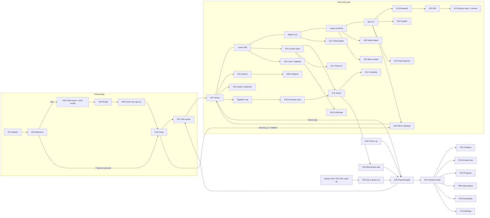

# Design: Kids Learning Platform

**Status: v1.0 draft for review (2026-11-18).** No application code. This folder is the single source of truth for design. It was reviewed against the recon and the architecture on 2026-11-18 (`docs/review/design-review.md`).

## 1. Files

| file | what it is | status |
| --- | --- | --- |
| `tokens/tokens.json` | design tokens: colour roles, type, space, radius, motion, sizes, breakpoints. **The only place values live** | current; 60 contrast pairs, 0 AA failures |
| `tokens/build_tokens.py` | generates `tokens.css`, `tailwind.preset.cjs`, `flutter_tokens.json` from `tokens.json` | current |
| `mockups/kids.html` + `screens/K*.png` | children's app mockups K01–K20 (tablet landscape; K07 also phone and web) | current; K18–K20 have no PNG yet |
| `components.md` | every component with variants, sizes, states, tokens, accessibility, screens | current (moved here from `replica/design/` and updated to v1.0) |
| `screen-specs.md` | written specs for every screen without a mockup: kids K21–K37, parent P01–P17, admin A01–A22 | current |
| `states.md` | loading, empty, error, offline and locked states for every screen | current |
| `interactions.md` | game, lesson, video, audio and reading requirements | current |
| `accessibility.md` | accessibility and child-friendly UX requirements, with the checks that prove them | current |
| `replica/design/*` | the first design pass (bottom tabs, the original's layout) | **superseded**; history only |

Tag legend as in `docs/architecture/README.md`: **[V]** verified, **[D]** decided, **[P]** proposal, **[A]** assumption, **[OPEN]**.

## 2. Information architecture (children's app)

### 2.1 The rail [P, design v1.0]

A left **navigation rail** replaces the original's floating bottom tab bar [V SS-01]. Five items, always in this order:

| rail item | colour family | contains | original's equivalent |
| --- | --- | --- | --- |
| **Home** | `kids-play-*` | "Keep going" (next lesson step), today's games, the **Together** row, new songs/videos, Explore (subjects), worlds and drops | Play tab + Explore |
| **Learn** | `kids-learn-*` | courses by stage, Learn Together courses, check-ins, certificates | Lessons tab |
| **Watch** | `kids-watch-*` | shows, episodes, video rows | Theater tab |
| **Listen** | `kids-listen-*` | Songs, Stories (read to me / read myself), Calm time | songs and audiobooks spread over Play/Theater |
| **Me** | `kids-me-*` | avatar and buddy, stars, sticker book, badges, garden (journey), saved games (favorites), switch player, Grown-ups | profile drawer + Sticker Album + Scene Book |

- **Search** is the first Home row header button and the Explore row (subject tiles) [F-040, F-043].
- **Grown-ups** is a fixed button in the top bar of every rail screen and in Me; it always opens the parental gate (K20).
- **Together** (the original's PlayTogether, must-have F-030) is a Home row plus Learn Together courses in Learn, with a two-player badge on cards [P, Q16]. A sixth rail item doesn't fit a phone in landscape (K07-phone: 5 × 56 dp items in 390 dp).
- **Favorites** live in Me › Saved games [F-022 equivalent of S22].

### 2.2 Why the change

The original's signature layout plus its signature colours is trade dress (replica-design rules). The rail also gives bigger targets on tablets, keeps content clear of the bottom edge where small hands rest, and fits portrait (it becomes a bottom bar, §4).

### 2.3 Sections and parental switches

Parents switch content off by **kind**, and it disappears on every screen, including Home and search [P]:

| switch | hides | default |
| --- | --- | --- |
| Learn | courses, lessons, check-ins | on |
| Watch | videos | on |
| Listen | songs, stories, audiobooks | on |
| Together | two-player activities | on |
| (games) | can't be switched off [V R14] | always on |

If every switch is off, the rail shows Home and Me only. Schema: `screen_time_rules.*_enabled`, `limited_sections` (`docs/architecture/database/schema-draft.sql`).

## 3. Navigation map

Back behaviour: the system back gesture (Android) and Esc (web) go up one level; in a game they open the pause sheet (K11 paused), never exit straight away; on the rail roots they do nothing (no accidental exit) [P].

## 4. Responsive specification

Window classes from `tokens.json › breakpoints` (Material 3 widths, used by both Flutter and Next.js):

| class | width (dp) | typical device |
| --- | --- | --- |
| compact | < 600 | phone portrait |
| medium | 600–839 | phone landscape, small tablet portrait, narrow browser |
| expanded | 840–1199 | tablet landscape, iPad portrait 834+, laptop browser |
| large | 1200–1599 | desktop browser |
| xlarge | ≥ 1600 | large desktop |

### 4.1 Children's app (Flutter: Android, iOS, web)

| | phone landscape (medium, height ≥ 360) | tablet landscape (expanded) | tablet portrait (medium/expanded) | web browser (expanded+) |
| --- | --- | --- | --- | --- |
| rail | compact rail 88 dp, icons only, 56 dp items (K07-phone) | full rail `kids-rail-w` 112 dp with labels (K07) | **bottom bar** 88 dp, icons + labels, 5 items | full rail; content max width 1440, centred |
| header | 64 dp; greeting + stars + Grown-ups | `kids-header-h` 80 | 80 | 80 |
| cards | 200 × 136 art, 1.5 rows visible | `kids-card-w` 240, art 160 (K07) | 240; 2.5 cards visible per row | 240; rows never wrap, they scroll; the next card peeks |
| hero ("Keep going") | hidden; becomes first card in row 1 | `kids-hero-h` 240 | 240 | 240 + "New song" tile beside it (K07-web) |
| games | template orientation; a "turn the phone" card if it doesn't match | template orientation | template orientation; landscape templates show "turn the tablet" | letterboxed to the template's aspect ratio; never stretched |
| video | full screen | full screen | full screen, portrait letterbox | in-page player with full-screen button |

Rules:
- **Phones**: Kids Area locked to landscape [V SS-01]. Minimum supported: 360 dp tall in landscape [Q19].
- **Tablets**: landscape and portrait. iPad Split View / Slide Over and Android multi-window must work, because iPadOS can't force an orientation in multitasking. Below 600 dp wide the shell switches to the bottom bar.
- **Web**: any window from 600 × 400 upwards. Below that, a friendly "make the window bigger" card. Mouse, touch and keyboard all work (arrow keys move between cards, Enter opens) [W-004].
- Tap targets never shrink below `tap-kids` 64 dp (secondary `tap-kids-secondary` 56) on any class. Content scales by showing fewer cards, never smaller ones.
- Safe areas (notches, home indicator, Android gesture bar) are padding, not content.

### 4.2 Parents Area (mobile app)

- Phones: portrait only [V SS-16], one column, `ui-content-max` irrelevant, 20 dp gutters.
- Tablets: any orientation; two columns ≥ 840 (list left 360 dp, detail right), like a settings split view.

### 4.3 Parent web and admin web (Next.js)

| class | parent web | admin web |
| --- | --- | --- |
| compact (< 600) | top bar + hamburger drawer; cards stack; charts become tables of 7 rows with "show more" | **supported read-only**: tables become cards; editing shows "use a larger screen" |
| medium | top bar + drawer; two-column stat grid | same as compact |
| expanded (≥ 840) | sidebar `ui-sidebar-w` 256 | sidebar 256; tables full |
| large+ | content max `ui-content-max` 1200, centred | tables use the full width; editor + live preview side by side ≥ 1200 |

- Text scales to 200 % without horizontal scrolling at 320 CSS px (WCAG 1.4.10 reflow) on the parent web.
- Every hover action has a focus and a touch equivalent.

## 5. Screen map

Mockup = drawn in `mockups/kids.html`. Spec = written in `screen-specs.md`.

| design id | screen | recon | flows | status |
| --- | --- | --- | --- | --- |
| K01 | Splash | — (new) | F01, F03 | mockup |
| K02 | Welcome | S01 | F01, F03 | mockup |
| K03 | Grown-up sign-up + consent | S03 | F01, F02 | mockup |
| K04 | Log in: code step (+ error) | S05 | F01, F03 | mockup |
| K05 | Child name + birth month/year | S02 | F01, F13 | mockup |
| K06 | Buddy (avatar) picker | S02, S33 | F01, F13 | mockup |
| K07 | Home (tablet, phone, web) | S09, S27 | F04, F06, F07 | mockup |
| K08 | Category (subject) page | S10, S11 | F06 | mockup |
| K09 | Course | S17 | F08 | mockup |
| K10 | Lesson path ("island") | S18 | F08, F25 | mockup |
| K11 | Game (+ paused, complete) | S13 | F04 | mockup |
| K12 | Watch library | S14 | F09 | mockup |
| K13 | Video player | S15 | F09 | mockup |
| K14 | Listen › Songs | S16 | F10 | mockup |
| K15 | Listen › Stories | S44 | F10 | mockup |
| K16 | Rewards | S24, S38 | F05 | mockup |
| K17 | Me (child profile) | S26 | F13 | mockup |
| K18 | Garden (learning journey) | — (new) | — | mockup, no PNG |
| K19 | Offline: saved on this device | S36 (kid side) | F15 | mockup, no PNG |
| K20 | Parental gate + device settings | S28, S37 (device part) | F12, F14 | mockup, no PNG |
| K21–K37 | search, saved, gift, sticker book, character pick, Learn Together, check-in, certificate, time's up, ask a grown-up, world, book reader, audio player, permission, who's playing, app update, free used up | S10, S22, S23, S24/S25, S45, S46, S19, S20, S30, S29, S11, S44, S16, S42, S26, —, S09 | F05–F11, F16, F22–F24 | spec |
| P01–P17 | Parents Area (app) and parent web | S04, S06–S08, S31–S37, S43 | F02, F12–F14, F17–F21 | spec |
| A01–A22 | admin CMS | — (not public) | X-003 | spec |

Out of scope for v1 (recon reference only): S39 teacher hub, S40 lesson plans, S41 printables.

## 6. Flow coverage

| flow | screens | taps (target from recon) |
| --- | --- | --- |
| F01 sign up, start free | K01 → K02 → K05 → K06 → K03 → K04 → P07 (free) → K07 | 7 (≤ 7) |
| F02 start trial | … K04 → P07 (trial) → store sheet → K07 | 8 + store |
| F03 log in on a new device | K02 → K04 → (K35) → K07 | 3 + email (= target) |
| F04 play, earn a star | K07 → K11 → K11 complete | 1 to start |
| F05 gift and decorate | K16/reward widget → K23 → K24 | 2 |
| F06 browse by subject | K07 → K21 (Explore tiles) → K08 | 2 |
| F07 world or collection | K07 → K31 | 1 |
| F08 complete a lesson | K07 "Keep going" or Learn → K09 → K10 → K11 / K27 → K28 | 2 to resume |
| F09 watch videos | Watch → K12 → K13 (auto up-next) | 2 |
| F10 listen to a story | Listen → Stories → K32 | 2 (target 2) |
| F11 play together | Home › Together → (K25) → K11 | 2 |
| F12 parent checks progress | Grown-ups → K20 → P01 → P04 | 2 + gate (target 2) |
| F13 add a second child | P01 → P02 → K05 → K06 | 3 + gate |
| F14 set a limit, block sections | Grown-ups → K20 → P01 → P03 | 3 + gate (target 4 + gate) |
| F15 download, play offline | P10 or row download button → K19 | 1 per row |
| F16 Basic child uses today's activities | locked card → K37 → K30 → K20 → P07 | — |
| F17 upgrade | P06 → P07 → store / P08 | 2 + payment |
| F18 redeem code | P09 (web) or P06 › "Have a code?" | 2 |
| F19 cancel | P06 → store instructions or Stripe portal | 2 |
| F20 change email | P13 → P17 re-auth → confirm | 3 |
| F21 delete account | P12 → P17 re-auth → confirm (7-day grace) | 3 |
| F22 mic or camera | K11 → K34 → K20 → OS prompt | 2 + gate |
| F23 Learn Together lesson | Learn → K09 (Together course) → K26 | 2 |
| F24 pick a character, race | Together row → K25 → K11 (E7) | 2 |
| F25 work through a unit | K10 step by step, auto-advance | 1 per step |

## 7. Terms

| design word (child-facing) | architecture / schema | recon (original) |
| --- | --- | --- |
| Course | `courses` | Lesson / workbook programme |
| (not shown to children) | `course_modules` | workbook |
| Island | `lessons` | unit |
| Step (Warm-up, Find, Trace, Sing, Story) | `lesson_steps.step_type` (`knowledge_check`/`intro`, `practice`, `trace`, `song`, `story`) | node |
| Island prize | `lessons.prize_reward_id` | — |
| Buddy | `avatars` | avatar |
| Saved games | `favorites` | Favorites |
| Surprise / gift | `gift_claims` (5 stars) | daily gift / sticker pack |
| Sticker book | `rewards (sticker)`, `child_rewards` | Sticker Album |
| Garden | `skill_mastery` bands via `GET /learning/journey` | — |
| Grown-up check | parental gate | Parental Gate |
