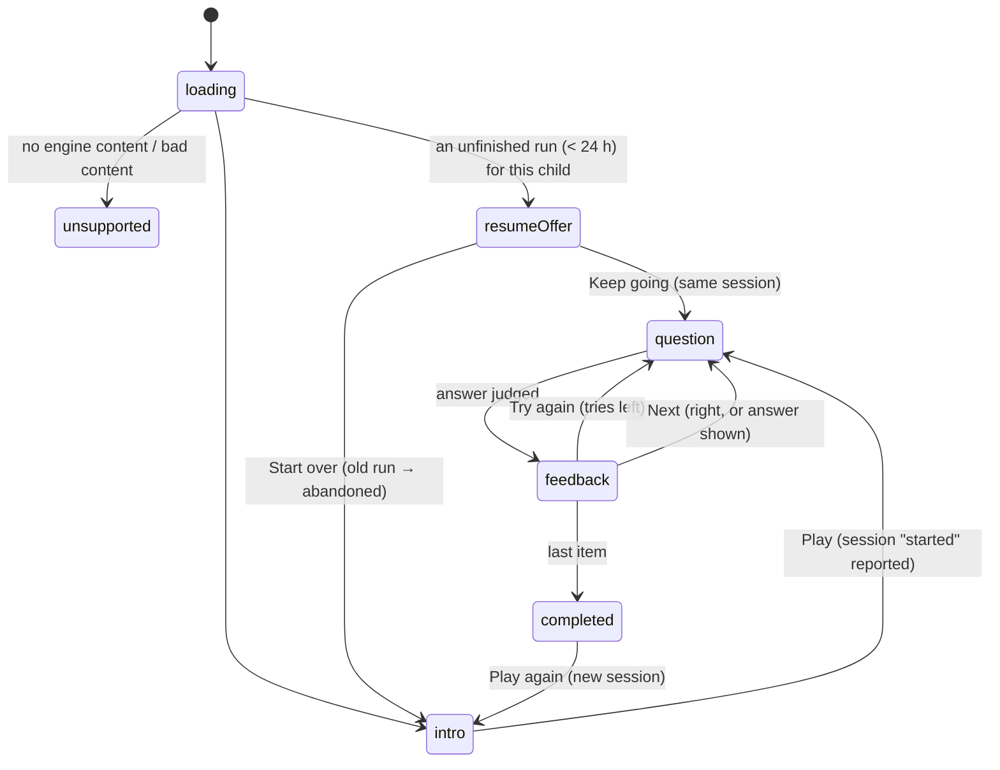

# Learning engine

Date: 2026-11-18 (Phase 9). Code: `kids_app/lib/features/play/`. One reusable player plays any activity whose content is engine items: 16 activity types today (`activity-types.md`; Phase 10 added `arithmetic`, `shape_complete` and `jigsaw`, plus game levels, sound effects and more: `docs/games/game-engine-integration.md`), more by registering a type.

Screenshots (web build, demo mode): `screens/K11-player-intro.png`, `K11-player-question.png`, `K11-player-try-again.png`, `K11-player-hint.png`, `K11-player-correct.png`.

## 1. Layers

```
domain/  (pure Dart, no Flutter)
  item_spec.dart        Prompt, Choice, PictureRef, ItemSpec (base), answers (sealed), Verdict, Hint,
                        DifficultyPolicy, SeededRandom
  registry.dart         ActivityKind<S> interface + KindRegistry (key → kind)
  kinds/*.dart          the 13 types: parse JSON, judge an answer, hints, the solution
  engine.dart           RunState (one run) + SessionEngine (the rules: answer, retry, hint, next,
                        pause/resume, snapshot/restore, play again)
  session_report.dart   ActivitySource (content), SessionReport (what is uploaded), SyncOutcome
  play_repositories.dart  ActivityContentRepository, PlayRepository, SessionStore (interfaces)
data/
  play_data.dart        Supabase content + /play/sync, on-device store (shared preferences), memory store
  quiz_mapping.dart     questions/answers rows → engine items
presentation/
  play_providers.dart   providers, SyncService (outbox), PlayerController (Riverpod Notifier)
  activity_player_screen.dart   the player: intro, items, feedback, pause, resume offer, completion
  views/item_views.dart ItemViewRegistry (key → view) + choice / place / order / memory views
  views/trace_view.dart tracing
  widgets/play_widgets.dart  PictureView, AnswerTile, PromptBar, ItemDots
```

A domain test fails the build if a domain file imports Flutter, Supabase or Riverpod.

## 2. How a run works



- **`SessionEngine`** is pure: every action takes a `RunState` and returns the next one. The UI, the tests and resuming share it.
- **Tries.** A wrong answer gives "Almost! Try again." until `maxAttempts` (3 for children under 6, 2 for older). After that the answer is shown ("Here's the answer!") and play goes on, so a child is never stuck.
- **Hints.** The lightbulb gives level 1 (spoken words), then level 2 (fewer options, the next letter, where the first token goes, one memory pair, the start of the stroke). Children under 5 are offered a hint straight after a wrong answer.
- **Score** (0–100): each item is worth 1 for right first time, minus 0.25 per wrong try, 0.1 per mistake inside the answer (a bounced drop, an extra memory flip) and 0.1 per hint level; at least 0.25 if right; 0 if the answer was shown. The completion screen turns it into 1–3 celebration stars. The **daily star** is the server's (one per activity per day).
- **Time** counts only active play: the intro, the pause sheet, the app in the background and reading feedback don't count.
- **Shuffling** is seeded by the session id, so a resumed run shows the same option order.

## 3. The player screen (K11 frame)

| part | what it does |
| --- | --- |
| intro | Bolt, a picture of the kind of game, the title, a short line, a big **Play** and a **Listen** button |
| top bar | Pause, progress dots (done = green), **Hint**, **Hear it again** |
| question area | the prompt (short text, a picture; audio questions show only a big listen button) and the item's view from the registry |
| feedback panel | slides up: "Great job!" / "You did it!" (right), "Almost! Try again." (+ "Show me a hint" for young players), "Here's the answer!" (out of tries); then **Try again**, **Next** or **Finish** |
| pause sheet | "Taking a break": Keep playing, Stop for now, Voice on / off |
| resume offer | "Keep going?": continue the same session where it stopped, or start over |
| completion | 1–3 stars, "You did it!", the server's answer ("You earned a star today!", "You finished the whole course!", or "Saved on this device…" when offline), then **Next step** (in a lesson) or **Next game**, **Play again**, **Back to the island** / **Home** |
| unplayable | videos, songs and stories (no engine content yet) and bad content: "Almost ready!" with Back |

System back and Esc open the pause sheet instead of leaving mid-game. Phones are held in landscape.

## 4. Child-friendly and accessible

- **Big targets:** answer tiles are at least 84 dp, kid buttons 64 dp. Checked by test at phone landscape (844 × 390), tablet and desktop for every type.
- **Little text, a voice:** prompts are one short line. Instructions, questions, letters tapped, memory cards and feedback are spoken. The voice is text-to-speech (`flutter_tts`; Web Speech API in browsers), automatic under age 6 and switchable in the pause sheet; the listen buttons always work.
- **Visual instructions:** a kind icon on the intro (a hand for tapping, a pencil for tracing, cards for memory), a green start dot and a dotted path for tracing, glowing targets for drops.
- **Gentle feedback:** wrong tiles shake (unless reduce motion is on) and say "not this one" to screen readers; right ones turn green. No timers, no lives, no losing.
- **Age:** `DifficultyPolicy.forChild(age, difficulty)` sets options shown (3 for toddlers up to 6 for confident readers), tries, auto-voice, hint offers, memory pairs and trace tolerance.
- **Screen readers and keyboards:** every tile, token, bin, card and puzzle piece is a labelled button ("fish", "water, has fish", "Card 3, face down", "Piece 2, in place 4, picked"). Every drag has a tap-tap alternative (tap the thing, tap where it goes). Enter and Space press tiles.
- **Reduce motion** stops the shakes, pops and bounces.

## 5. Adding an activity type

1. Domain: a class `XKind extends ActivityKind<XSpec>` with `key`, `parse`, `evaluate`, optionally `hint` and `solution`. Register it in `KindRegistry.standard()`.
2. View: a widget that takes an `ItemViewContext` and calls `ctx.submit(answer)`. Register it in `ItemViewRegistry.standard()` under the same key.
3. Content: items with `"kind": "x"` in `games.config.items`.

Nothing in the player, the engine, scoring, sync or storage changes. `test/widget/engine_extension_test.dart` proves it with a "drum" type written only in the test.

## 6. Content source

| activity | items come from |
| --- | --- |
| games | `games.config` → `{"intro": …, "items": [ {"kind": …}, … ]}` |
| quizzes | the `questions` / `answers` tables, mapped by `quiz_mapping.dart` (choice, listen-and-choose, match, order) |
| videos, songs, stories | nothing yet → "Almost ready!" (players come in M4) |

Content that fails to parse never crashes the player: the activity shows "Almost ready!" and the parse error is a `ContentException`. A test parses all development content for ages 2, 4, 6 and 9.

## 7. Not in this phase

Real artwork and recorded voice (the `PictureRef` and `SpeechService` seams are ready); video, song and story players; `play/launch` (entitlement, free allocation and screen-time gate before play); `play/heartbeat`; gifts, mastery and badges after a session (server, later modules); the admin authoring screens for items (A04 / A05).
