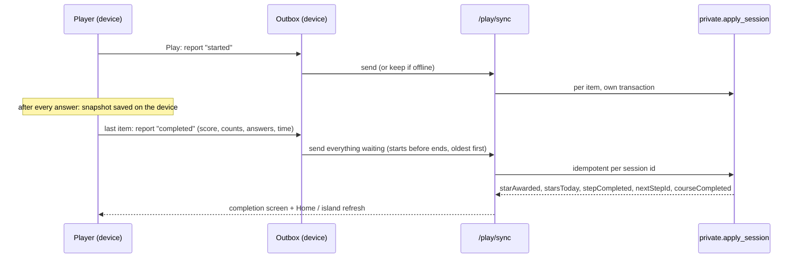

# Progress tracking

Date: 2026-11-18 (Phase 9). Every run of the player is a **session** with an id made on the device. The app reports it twice: when play starts and when it ends. The server writes the tables, awards the star and unlocks the next step. The app never writes progress tables itself: clients have no write access to them.

## 1. What is tracked, and where

| brief | where it is stored | set by |
| --- | --- | --- |
| child id | `activity_sessions.child_id` | the app names it; the server checks the child belongs to the signed-in parent (404 otherwise) |
| activity id | `activity_sessions.activity_id` (+ `lesson_step_id` from an island) | app; server checks it's published and the step belongs to it |
| started / completed timestamps | `activity_sessions.started_at`, `ended_at`, `local_date` (the **household's** day, from its timezone) | app times, sanity-checked by the server (no future, nothing older than 30 days, at most 4 hours) |
| answers | quizzes: `question_responses` (one row per question and attempt, with `answer_id`). Games: `activity_results.metrics.items` (per item: type, right, wrong tries, mistakes, hints, answer shown, time) | app |
| correct / incorrect counts | `activity_results.correct_count` / `total_count`; wrong tries + mistakes in `metrics.incorrect` | app (engine) |
| score | `activity_results.score` (0–100) | app (engine); `lesson_step_completions.score` copies it |
| attempts | per question in `question_responses.attempt`; per item in `metrics.items[].w`; repeated plays in `metrics.run` | app |
| time spent | `activity_results.duration_ms` (active play only) and `daily_progress.seconds_played` | app; server rolls up |
| completion status | `activity_sessions.status` `started` → `completed` / `abandoned`; `activity_results.completed` | app reports; server keeps the history honest |
| stars, unlocks | `star_awards` (one per activity per household day), `daily_progress`, `lesson_step_completions`, `course_enrollments.current_step_id` / `status` | **server only** |

No new tables. One new SQL function: `private.apply_session` (migration `20261118001500_apply_session.sql`), behind the new Edge Function `POST /play/sync` (`supabase/functions/play`).

## 2. Flow

## 3. Saving securely

- **Identity from the JWT only.** The Edge Function takes the user from the verified token; `apply_session` checks the child is in that user's household and returns 404 otherwise. Tested: Bob can't write Leo's session (SQL test P1).
- **Idempotent.** The session id is generated on the device. A replay of the same report is `duplicate` and changes nothing. A `started` session can become `completed` or `abandoned` once; after that it's final. A session id reused for another child is a conflict (409).
- **Honest history.** Plus content played without Plus (offline, or a stale app) is recorded but earns no star and unlocks nothing.
- **Server-side rules.** One star per activity per household day (primary key), the household day from the account's timezone (not the device clock), clamped times, score 0–100, at most 20 attempts per question, `metrics` capped at 8 KB.
- **Validated twice.** zod in the Edge Function (types, enums, ranges, ≤ 100 items, payload ≤ 500 KB); constraints and checks again in SQL. One bad item is "rejected" without blocking the others.
- **Nothing private on the device.** The outbox and snapshots hold ids, counts and answers of a game (no names, no emails), in app storage (shared preferences; browser storage on the web).

## 4. Interrupted sessions

| what happens | result |
| --- | --- |
| the child taps Pause → "Stop for now", presses Back, or the app goes to the background | the run is **saved** on the device (snapshot after every answer anyway). It is *not* reported as abandoned, so finishing it later still counts |
| the child opens the same activity again within 24 hours | "Keep going?" → **Keep going**: same session id, same item order, same progress, at the next unfinished item. Time already played is kept |
| … and chooses **Start over** | the old run is reported as **abandoned** (with what was done), a new session starts |
| the snapshot is older than 24 hours | closed as abandoned automatically; a fresh run starts |
| the content changed since the snapshot | the snapshot doesn't match the items: closed as abandoned, fresh run |
| the app is killed mid-game | the last snapshot is on the device; next open offers to keep going |
| offline when the run finishes | "Saved on this device. It will be sent when you are online." The report stays in the **outbox** and goes with the next game, the next app start or the next sign-in. Stars appear then |

The outbox keeps at most 200 reports; rejected reports are dropped rather than retried forever.

## 5. After a session

`SyncService` invalidates the child's progress, so Home ("Played lately", today's stars), the island (step done, next step open) and the course % refresh. The completion screen's **Next step** uses the server's `nextStepId` logic, mirrored by the app's rules, to open the next step's player directly.

## 6. Not yet

`play/launch` (checks Plus, the free daily allocation, screen time and app version before play), `play/heartbeat` (screen-time counting), the device clock offset (sent as 0 today), gifts / skill mastery / badges / certificates in `apply_session` (their modules), sign-out clearing another family's outbox on shared devices (reports are rejected server-side, so nothing leaks, but they wait until dropped).
