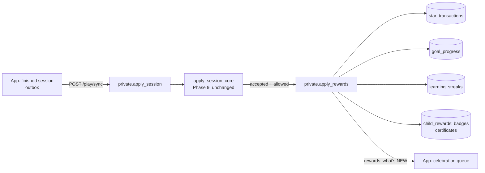

# Reward system

Phase 12, 2026-11-21. How children earn stars, bonus stars, badges, goals and learning days, and how this is kept fair, safe and gentle. Badges: `achievement-system.md`. Streaks and time zones: `streak-system.md`. Tests: `testing-report.md`. Screenshots: `screens/`.

**Status.** Built and tested:
- on the local Postgres test database (migration, seed and SQL suite R1);
- on the demo backend, in widget tests;
- in rendered screenshots.

It has **not** run against a live Supabase project, because none exists yet.

## 1. Principles

The brief: no manipulative mechanics, no competitive pressure, no endless engagement loops. Design rule C6 (`docs/design/accessibility.md`): no streak-loss threats, and rewards are never taken away.

| we do | we don't |
| --- | --- |
| reward **finishing** something (an activity, an island, a course) | pay for time spent, taps or logins |
| one star per **different** activity per day, so variety counts | pay for replaying the same game, so there's nothing to grind |
| small daily and weekly goals a **parent** sets or switches off | set targets that grow by themselves |
| forgive a rest day in a learning streak, and keep the best streak | say "you lost your streak", or send come-back reminders |
| keep stars forever | take stars away, spend them, or sell them |
| celebrate once, briefly, with one tap to close; reaching the daily goal suggests a break | chain pop-ups, add "play more" buttons, or use countdowns or random prizes |
| show each child only their own progress | leaderboards or comparisons between children |

## 2. How it fits the existing engine

Nothing was duplicated. The Phase 9 engine (`private.apply_session`, called by `POST /play/sync`) still records sessions and decides the activity star:
- `star_awards`: one per distinct activity per household day, enforced by its primary key;
- steps, enrolments and the daily roll-up.

Phase 12 adds **one reward step after it**, in the same transaction:

- **The wrap.** `apply_session` was renamed `apply_session_core`, unchanged. A new `apply_session` calls it, then `apply_rewards`. The Edge Function and its callers are untouched, and the session logic isn't copied.
- **What's new.** `apply_rewards` returns only what this call newly earned. The sync response carries it as `rewards`, and that is all the app celebrates.
- **Allowed only.** Rewards run only for completed, allowed sessions. Plus content played without Plus earns nothing, the same rule as the Phase 9 star.

### Tables

| | | |
| --- | --- | --- |
| `star_awards` | existing | "this activity earned its star today" (the rule) |
| `rewards` (type `badge`) | existing, + `description`, `how_to_earn`, `rule_params`, `bonus_stars`, `sort` | badge catalogue |
| `child_rewards` | existing | badges earned; `first_earned_at` is the earned date |
| `certificates` | existing (now issued) | one per finished course |
| `daily_progress` | existing | daily roll-up for reports |
| **`reward_rules`** | new | configurable star amounts per event |
| **`star_transactions`** | new | the star ledger: every star with its reason |
| **`learning_goals`** | new | per-child goal settings (parent) |
| **`goal_progress`** | new | per child, per day / week |
| **`learning_streaks`** | new | current and longest streak |
| **`child_star_totals`** (view) | new | balance per child (`security_invoker`, so RLS applies) |

Why each is new is in `docs/backend/database-schema.md` §5, deviations #13–#17.

## 3. Stars

### Rules (`reward_rules`, editable by content admins)

| key | default | when |
| --- | --- | --- |
| `activity_completed` | 1 | an activity's star for the day (`star_awards` decides) |
| `daily_goal_met` | 1 | the day's goal is reached |
| `lesson_completed` | 2 | every required step of an island is done |
| `weekly_goal_met` | 2 | the week's goal is reached |
| `course_completed` | 5 | every required step of a course is done |
| (badge) | `rewards.bonus_stars`, 0–3 | a badge is earned |

How the rules behave:
- **Changing a rule.** Only new rewards use the new amount. Past ledger rows keep theirs.
- **Switching a rule off** (`active = false`). It pays nothing, and no zero-star rows are written.
- **Limits.** The check constraints keep each amount between 0 and 10.

### Once-only keys

Every reward is a ledger row with `unique (child_id, reason, ref_key)`, and every insert is `on conflict do nothing`. So the same reward can never be paid twice, however often a session is retried, replayed or synced late.

| reason | `ref_key` |
| --- | --- |
| `activity_completed` | `activity:<activity id>:<household date>` |
| `lesson_completed` | `lesson:<lesson id>` |
| `course_completed` | `course:<course id>` |
| `daily_goal_met` | `day:<household date>` |
| `weekly_goal_met` | `week:<monday>` |
| `badge` | `badge:<reward id>` |

- **Positive only.** Amounts must be 1–20 (constraint), so stars can't be taken away.
- **The balance** is `sum(amount)`, through the `child_star_totals` view. Home, the top bar and Me all show it.
- **"Today's stars"** is still the number of activity stars today, which is what the daily goal counts.

## 4. Goals

| | counts | default | parent can set |
| --- | --- | --- | --- |
| daily | **different** activities finished today (= activity stars today) | 3 | 1–10, or goals off |
| weekly | **learning days** this week, Monday–Sunday, household zone | 4 | 1–7, or goals off |

- **Reached once.** A goal is reached the first time progress ≥ target. It then gets `completed_at`, a bonus star and a celebration, once. After that, progress keeps counting with no more bonuses. Home says "Every star after this is a bonus".
- **Changing a goal mid-day.** A goal already reached **stays reached** if a parent raises the target later in the day. Its target is frozen in `goal_progress`. A goal not yet reached follows the new setting at once.
- **Goals off.** Nothing is tracked or shown, and stars and badges keep working.
- **Where it's set.** P18 (Parents → Manage children → a child → Rewards and goals), through `PUT /children/:id/goals`. The input is validated and the request must come from the child's own household.

## 5. Celebrations and animations

**When they happen.** `SyncService` puts the server's `rewards` into a celebration queue. It does this only when the item came back `accepted`, so a `duplicate` replay or a failed upload celebrates nothing. Offline play is celebrated **once, when it's confirmed**.

**Where they show.** `CelebrationHost` sits above the router. It shows the selected child's next celebration only on kid screens. It waits while a grown-up is in the parents area, and another child's rewards wait for that child.

**What they look like:**

| earned | shown |
| --- | --- |
| stars only | a small "+1 star!" banner at the top for about 3 s that closes itself, with no button and no blocking |
| anything else | **one** card for everything that session earned, closed with "Yay!" |

The card leads with the most special thing earned:
1. a course;
2. a badge (its picture);
3. a streak milestone (3, 7, 14, 30, 50, 100 days);
4. the weekly goal;
5. the daily goal;
6. an island.

The rest of what was earned is listed under it, plus "+N stars". If the daily goal was reached, the card adds "Great learning today. Maybe time for a break?". The card never links to more play.

**The animations** are all drawn in code (`CelebrationBurst`), original, and play once, under 2 s:

| style | animation |
| --- | --- |
| stars | stars burst out and fade |
| badge | soft rays turn behind the badge as it pops in |
| goal | a ring of stars |
| course | confetti shapes fall |
| milestone | stepping stones light up one by one |

**Reduced motion.** With the system setting on, every animation shows its final still picture:
- the burst and the pop-in don't move;
- goal rings appear already filled;
- the banner doesn't slide.

Tested: no animation runs with the setting on, and with it off the card animates once and stops.

## 6. Screens

| screen | what |
| --- | --- |
| **K16 My rewards** (`/kids/me/rewards`, from Home's goal card, Home's treasures "See all", and Me) | balance with "How do I get stars?"; Today and This week rings; days in a row, best and a 6-week calendar; "New for me" (last 5 ledger rows); "What I did" (learning days, daily goals, great weeks, islands, courses); all 16 badges, earned first, each opening a sheet with its date or how to earn it |
| Home goal card (K07) | the parent's target (drawn stars up to 5, a bar above that); the server's status, so a goal reached stays reached; hidden when goals are off |
| **P18 Rewards and goals** (`/parents/children/:id/rewards`) | overview; calendar; goals form (switch, daily 1–10, weekly 1–7; Save is off until something changes); badges earned with dates, plus "Still to earn"; star history (last 50, with reasons); "How rewards work" and "What we don't do" |

**Against the design** (`docs/design/README.md`, `components.md`):
- K16 is the designed Rewards screen, and P18 is a new parent screen, the next free id.
- Not-yet badges show their picture in grey, not an outline with "?", so children can see what they're aiming for. They're still announced as "not yet".
- Badge tiles have no per-badge progress bars, as the design asks. Goal rings are separate, because the brief asks for goal progress.
- K16's 5-slot gift arc and K23/K24 (gift and sticker book) belong to the sticker flow, F05, which this brief didn't include.
- Q17 suggested badges behind a feature flag. There is no flag yet; switching goals off is per child.

## 7. API

| route | function | notes |
| --- | --- | --- |
| `POST /play/sync` | `private.apply_session` → `apply_rewards` | each accepted, allowed, completed item gets `rewards: {stars, transactions[], badges[{key, title, bonusStars, art}], goals[{period, target, progress, completed, justCompleted}], lessonCompleted, courseCompleted, streak{current, longest, grew}, balance}` |
| `GET /children/:id/rewards` | `private.rewards_summary(user, child)` | today, weekStart, balance, streak, goals, day, week, learningDays (42 days), transactions (50), badges (all, with `earnedAt`), counts, rules. Errors: KL404 for another household's child |
| `PUT /children/:id/goals` | `private.set_learning_goals(user, child, p)` | `{enabled?, dailyActivities? 1..10, weeklyDays? 1..7}`, partial; zod in the Edge Function and checks in SQL; KL400, KL404 |

There is **no award endpoint.** A client can't ask for stars or badges.

## 8. Security

- **Reads.** Parents read only their children's rows (RLS `child_read` via `private.can_access_child`). Support staff with `support.read` can read them too.
- **No client writes.** `insert`, `update` and `delete` are revoked from `anon` and `authenticated` on every new child table. Tests T1 and R1 check this, and T2 covers isolation for every table with a `child_id`.
- **Rules.** Readable by everyone; writable only with `content.write` (admins).
- **Functions.** All new functions are `security definer` with an empty `search_path`, revoked from clients, and granted to `service_role` only.
- **The service key** stays in the Edge Functions, as before.
- **Time can't be gamed.** The household day comes from `parent_accounts.timezone`, never the device. Session times are corrected by the measured clock offset and clamped (Phase 9).

## 9. Offline and retries

- **Offline play.** Finished sessions wait in the device outbox (Phase 9) and are sent later.
- **Duplicates.** A replay returns `duplicate` and earns nothing. A late session lands on its own household day, and goals, streak and badges are recomputed from the facts.
- **Celebrations** follow the server's answer, so a reward is never celebrated before it exists, and never twice.

## 10. Before applying the migration (review)

`20261121000100_rewards.sql`:
- **Renames** `private.apply_session` to `apply_session_core` and adds the wrapper. Grants are re-applied: the wrapper goes to `service_role`, and core is revoked from everyone.
- **Backfills.** Its last block runs `apply_rewards` over **every completed session**, oldest first. This is idempotent, so it gives existing children their ledger, goals, streak and badges.
  - On a large production database, run it in batches.
  - The backfill sets goal `completed_at` and badge dates to the migration time, not the historical time.
- **Constraint.** Adds `badge_rule_known` to `rewards`. Existing badges must use a known rule; the seeded ones do.

## 11. Not done

- **Stickers and gifts** (F-101 to F-103: 5 stars → a sticker pack, Sticker Album, Scene Book). The tables exist from Phase 5, but they weren't in this brief.
- **A certificate view** (F-104). Certificates are issued, but not shown.
- **Celebration sounds** (the sound-effects service exists).
- **Monthly achievement cards** (F-105).
- **An admin CMS screen** for reward rules and badges. Today they are seeded and edited with `content.write` SQL.
- **Per-family rule overrides.**
- **Badge text in other languages.** The columns are localized jsonb, but only English is seeded.
- **A live Supabase run, and devices.**
