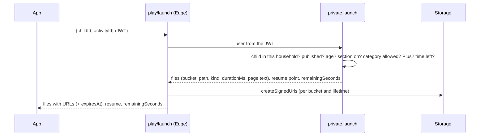

# Media architecture

Phase 11, 2026-11-21. How videos, songs and stories are stored, protected, launched, played and tracked. The module pages are `video-module.md`, `music-module.md` and `stories-module.md`; the tests are in `testing-report.md`.

**Status.** Built and tested on the demo backend, the local Postgres test database and in a browser (web build). It has **not** run against a live Supabase project, because none exists yet, and not on iOS or Android devices.

## 1. Content: original development media

There was no media in the project, and the brief forbids third-party content. So `content/dev-media/make_dev_media.py` **generates** a small, original library from code:

| | items | how it's made | size |
| --- | --- | --- | --- |
| videos | Pip meets a snail, Numbers on the farm, Why does it rain? (Plus), Shapes all around, Rainbow colours | frames drawn with Pillow (our own characters Pip, Bolt, Nova as simple shapes) → H.264 + AAC via ffmpeg, 640×360, `+faststart`; music composed in the script; **WebVTT captions** for every video | 32–36 s each, 2.2 MB in all |
| songs | The counting train, Ten little seeds, How do you feel?, Tidy-up tune, Moon lullaby | original tunes written in the script (melody, chords, bass, soft percussion) → AAC 64 kbps | 45–61 s each, 2.3 MB |
| stories | The sleepy cloud (Plus), Bolt takes a breath (Plus), Pip and the lost seed, Nova counts the stars | 6 illustrated pages each (WebP 960×600) + the words of each page | 0.5 MB |
| thumbnails / covers | every item | WebP at 256 and 512 px | 0.1 MB |

What this content is not:
- **Songs are instrumental.** Nothing is sung.
- **Videos have music and on-screen words but no narration.** Their captions carry those words and describe the sounds.
- **Stories are narrated by the device's text-to-speech.** No recorded narration exists. The player supports recorded narration (`page_audio`), but it has only been tested with fake files.

This is development content. Real content comes through the content pipeline and the CMS (`docs/architecture/11-media-storage.md` §11.4).

The files sit in `kids_app/assets/dev_media/<bucket>/<path>`, laid out exactly like Storage, so demo mode can play them offline.
- **Registry.** The script writes `assets/dev_media/manifest.json` and `lib/demo/demo_media.g.dart` (bucket, path, kind, MIME, bytes, sha256, size, length, story text).
- **Seed.** Seed §16 is generated from these by `dart run tool/seed_content_sql.dart --write`. It holds the `media_assets` rows (sha256 included), `activity_media` links, new activities and categories, and the Watch / Listen rows.
- **Upload.** `scripts/upload-dev-media.sh` puts the files in a linked Supabase project's buckets. It uses your CLI login; no keys are stored.
- **Not for release builds.** The bundled `dev_media` assets are for demo mode. A release build should drop them from `pubspec.yaml`: about 4.5 MB.

## 2. Storage and protection

| bucket | holds | access |
| --- | --- | --- |
| `public-assets` | thumbnails, covers | public CDN URL (no secrets; paths are versioned, so caches never go stale) |
| `video` | `<id>/mp4/540p.mp4`, `<id>/subs/<locale>.vtt` | **private**: signed URLs only |
| `content` | `songs/<id>/<locale>.m4a`, `<id>/<version>/pages/<n>.webp` | **private**: signed URLs only |

Clients have **no Storage policies** on `video` or `content`. Phase 5 set that up and it is unchanged; it is checked by T1.
- **Signing.** Only the Edge Function `play/launch` signs, using the service role key from its own environment. That key never reaches an app.
- **Lifetimes.** A video URL lives for the video's length + 1 hour, because players stream in byte ranges for as long as the child watches. Everything else lives 15 minutes.
- **Accepted risk** (as in 11.3): a signed URL can be shared until it expires.

## 3. The launch gate: `POST /play/launch`



| check | refusal | the child sees |
| --- | --- | --- |
| not their child / not published (draft, in review, retired) | 404 | "Almost ready!" (not available) |
| outside the age window | 403 `AGE_NOT_SUITABLE` | "Not today" |
| section off (Watch / Listen) | 423 `SECTION_DISABLED` | "Not today: a grown-up switched this off" |
| category blocked | 423 `CATEGORY_BLOCKED` | same |
| Plus item, Basic family | 402 `NEEDS_PLUS` | "Ask a grown-up!" (K30) |
| today's limit used up | 423 `SCREEN_TIME_OVER` | "That's all for today!" (K29) |

The Basic **free daily allocation** isn't built yet (billing module), so Plus items are simply refused for Basic families.

## 4. Schema changes (migration `20261120000100_media.sql`, documented)

| change | why |
| --- | --- |
| `screen_time_rules.blocked_category_ids uuid[]` | the brief's "parent-controlled access to media categories"; the reviewed schema only had whole-section switches. One column on the existing per-child rules row: same RLS, same write path, `'{}'` = nothing blocked |
| `activity_media.text jsonb` | a story page is a picture **and words**; the words had nowhere to live. Localized text on the page's own row |
| `private.launch`, `private.add_screen_time`, `private.set_screen_time_rules` (+ helpers) | service-only, `security definer`, empty `search_path`, household check, KL4xx errors, as in Phases 5–9 |

**No new table for playback progress.** A media session that ends early is reported to `play/sync` as `abandoned` with `metrics {positionMs, durationMs}` (or `{page, pages}`). `launch` and the progress read take the newest unfinished one. So watch history, recently played, continue watching and reading progress all come from `activity_sessions` + `activity_results`, which the app already reads under RLS.

## 5. In the app (`kids_app/lib/features/media/`)

```
domain/media.dart          MediaFile, MediaLaunch, PlaybackSnapshot, MediaRules (resume, finished,
                           visible, continue list, recommended), MediaFilter (search), SongQueue
                           (repeat, shuffle), StoryPage, splitSentences, StoryRules     (pure Dart)
domain/media_repositories  MediaRepository (launch, heartbeat), MediaControlsRepository,
                           MediaPositionStore
data/media_data.dart       Supabase (functions), PrefsMediaPositionStore, MemoryMediaPositionStore
presentation/players.dart  MediaBackend → VideoPlayerBackend (video_player), JustAudioBackend
                           (just_audio + just_audio_background + audio_session)
presentation/media_providers.dart
                           MediaSessionTracker (session reports, heartbeats, positions),
                           VideoController, AudioController (one, app-wide), StoryController
presentation/screens/      MediaLibraryScreen (Watch, Listen), VideoDetailsScreen,
                           VideoPlayerScreen, SongPlayerScreen + MiniPlayer, StoryReaderScreen
presentation/widgets/      MediaThumb, SeekBar, BufferingIndicator, MediaStateView, SpeedButton,
                           MediaShelf
parents/.../media_controls_screen.dart   P03
```

- **Players behind an interface.** Screens never touch a plugin. Tests use fake players (`test/helpers/fake_media.dart`), and a plugin can be swapped without UI changes.
- **One session path.** Every play is a session reported the same way as games:
  - started on the first play;
  - completed (≥ 95 %, or the last page of a story) or abandoned with the position;
  - through the outbox, so it works offline.

  The server's `apply_session` awards the **daily star** (F-074) and completes **lesson steps** when the video, song or story was opened from a course island.
- **Positions in two places:**
  - on the device: saved every 5 s while playing, on pause and on leaving, for an instant resume and for interruptions;
  - on the server: in the session's metrics, so resuming works on any device.

  The newer of the two wins.
- **Heartbeats.** `play/heartbeat` gets the active seconds every 30 s. When the server answers `locked`, playback pauses and the child sees K29.

## 6. Parental controls

P03 (Parents → Manage children → a child → Media and screen time) offers:
- Videos on / off;
- Songs and stories on / off;
- each category on / off;
- a daily limit (none, 15–180 min) and which of videos / songs and stories it counts.

Games are always on and never limited. The app hides what's off everywhere: the rail, Watch, Listen, Home "Played lately", subject pages. The server refuses it at launch even if the app is out of date. Age filtering is automatic: a child only sees and can only open items for their age.

## 7. Performance and slow networks

| concern | what's done |
| --- | --- |
| thumbnails | 256 or 512 px file chosen by the size shown; decoded at that size (`ResizeImage`), not full size; a drawn placeholder while loading or if offline |
| long lists | shelves are lazy horizontal lists (`ListView.builder`); the page is a lazy `ListView` |
| not downloading whole videos | progressive MP4 with `faststart` streamed in **byte ranges** by the platform player (Supabase Storage supports ranges); captions are a few KB |
| slow internet | "Loading" while buffering; after 8 s "Slow internet… still loading"; errors show "Try again", which reopens **where it stopped** |
| offline | launch fails → "You're offline… games still work!" with Try again; sessions wait in the outbox |
| timeouts | 15 s for captions, 25 s to open a file |

Not done:
- HLS adaptive streaming. The `media/hls` route isn't built, so HLS-only videos show "not available".
- Offline downloads (`library/downloads`).
- An image disk cache on mobile (`cached_network_image`): images use the platform's HTTP cache only.

## 8. Platforms

| | done | to check on devices |
| --- | --- | --- |
| background audio | Android: `AudioServiceActivity`, foreground media service, permissions; iOS: `UIBackgroundModes audio`; `JustAudioBackground.init` at start (mobile only) | lock screen controls, phone-call interruptions (`audio_session`) |
| video | `video_player` on iOS, Android, web | real devices; web autoplay needs a tap (browsers block sound otherwise) |
| narration | `flutter_tts`: iOS / Android voices, the Web Speech API in browsers | voice quality per device |
