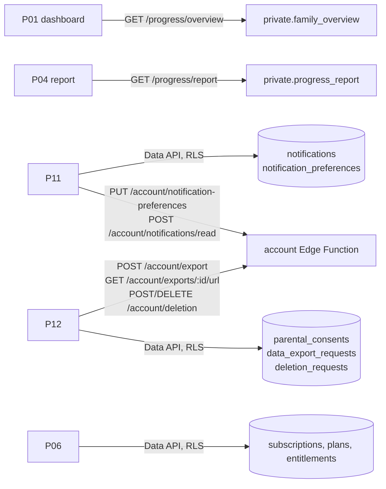

# Parent dashboard

Phase 13, 2026-11-22. The Grown-ups area: dashboard (P01), progress report and analytics (P04), notifications (P11), privacy and data (P12), subscription (P06), plus the existing children (P02), controls (P03) and rewards and goals (P18) screens. Other docs in this folder:
- `analytics.md`: report and chart definitions;
- `parental-controls.md`;
- `subscriptions.md`;
- `testing-report.md`.

Screenshots: `screens/`.

**Status.** Built and tested:
- on the local Postgres test database (migration `20261122000100_parent_dashboard.sql`, SQL suite D1);
- on the demo backend (unit and widget tests);
- as rendered screenshots.

**Not run** against a live Supabase project (none exists yet) or on devices.

## 1. Brief → status

| brief | status | where |
| --- | --- | --- |
| overview of all children | done | P01, one card per child (`GET /progress/overview`) |
| child profile cards | done | avatar, name, age; buttons: report, settings and controls, rewards and goals |
| total learning time | done | today, this week, all time per child; this week for the family |
| lessons completed | done | lessons (islands) with every required step done |
| games completed | done | completed game sessions |
| current learning streak | done | learning days in a row, and best (Phase 12 rule) |
| stars and achievements | done | star balance, badges earned |
| daily and weekly goal progress | done | bars from the rewards summary (a reached goal stays reached); "goals are off" when switched off |
| recent learning activities | done | last 3 on the card (title, kind, finished / stopped early, time); last 50 in the report |
| progress reports (day / week / month) | done | P04, see `analytics.md` |
| learning analytics charts | done | P04, six charts, each with a table |
| parental controls | done, with limits listed in `parental-controls.md` | |
| multiple children | done | a card each; a child picker in the report; separate goals, controls, exports; household isolation tested |
| subscription management | done as far as no payment connection allows | P06, see `subscriptions.md` |
| notifications | in-app done; **email and push not connected** | P11 |

## 2. Screens

| id | route | what |
| --- | --- | --- |
| P01 | `/parents` | Shows: • "Your children" (Manage children, Add a child) • this week's family totals • child cards • family settings: Subscription (Plus until … / Basic), Notifications, Privacy and data • account (email, sign out)  The bell in the app bar shows the unread count. Pull to refresh. |
| P04 | `/parents/children/:id/report?period=day\|week\|month&date=YYYY-MM-DD` | the report and analytics (`analytics.md`); a child picker; Day / Week / Month; previous and next (no "next" into the future) |
| P11 | `/parents/notifications`, `/parents/notifications/settings` | inbox (tap marks read, "Mark all as read"); a switch for each type |
| P12 | `/parents/privacy` | consents given, with dates; data export (a child or the account); delete a child (via P02); delete the account (7 days, cancellable) |
| P06 | `/parents/subscription` | plan, status, store, dates, Plus access; manage and cancel; plans for Basic; restore |

**Every screen has three states:**
- **Loading:** skeletons or a spinner.
- **Error:** the error view with "Try again".
- **Empty:** "No child profiles yet" with Add a child; "No activity in this week"; "No notifications yet"; "No consents recorded."

**Layouts** are tested at phone, phone held sideways, tablet and desktop: tap targets, labels, contrast and overflow. On the dashboard, the child-card tiles go two, three or four per row, depending on the card's width.

**Children can't reach any of this.** Every `/parents/...` route sits behind the grown-up gate (a widget test opens each new route from the kid zone and gets the gate). Account-level actions also need a recent sign-in on the server.

## 3. Data flow

- **Two new Edge Functions:**
  - `progress` (read-only: `overview`, `report`);
  - `account` (writes).
- **Every SQL function** is `security definer` with an empty `search_path`, is service-only, and checks the household (`household_of_child` or `account_of_user`).
- **Clients write nothing directly.** Their reads go through RLS, which T2, D1 and R1 check.
- **In the app:**
  - `ParentReportsRepository` and `AccountRepository`, under `features/parents/domain`;
  - the Supabase versions in `data/supabase_parent_data.dart`;
  - a demo version in `DemoBackend` and `demo/demo_reports.dart`, with the same definitions;
  - Riverpod providers in `presentation/parent_providers.dart`.

## 4. Notifications

| type | when | written by |
| --- | --- | --- |
| `weekly_progress` | the household's Monday: last week for each child (learning days, activities, time, stars) | `private.queue_due_notifications`, hourly (pg_cron) |
| `goal_reached` | a child reaches a daily or weekly goal (once per goal) | `apply_session`, after the rewards step |
| `account_security` | a child profile was deleted | trigger on `deletion_requests` |
| `deletion_scheduled` | the account is set to be deleted | trigger on `deletion_requests` |
| `export_ready` | a data export is ready | `private.finish_export` |
| `subscription_changed`, `billing_issue` | the billing service changes a subscription's status | trigger on `subscriptions` |
| `trial_ending` | two days before a trial ends | `private.queue_due_notifications` |

- **One function sends them all.** Every notice goes through `private.notify(account, type, params, dedupe_key)`:
  - one in-app row per parent of the household;
  - **skipped if that parent switched the type off;**
  - never twice for the same dedupe key (unique `(user_id, dedupe_key)`).
- **No nicknames in notices.** They carry child ids, and the app writes the words, filling in nicknames on the device.
- **Delivery today is in-app only.** Email and push need a sender (Resend or Postmark, APNs or FCM) that isn't configured. The settings screen says so and offers in-app switches only, so it doesn't show switches that wouldn't do anything. The table already stores per-channel preferences for when a sender exists.
- **Manual setup.** Enable **pg_cron** in the Supabase dashboard. The migration schedules `parent-notifications` (hourly) only if the extension exists. Until then, weekly summaries and trial reminders aren't produced; the function is tested in D1.

## 5. What this phase changed in existing code

- **The dashboard replaces the foundation P01.** Sign-out and account info are kept.
- **P03** gained the Learn and Together switches, which were stored but had no UI, and a note on how content follows the child's age.
- **P02**'s child page gained a "Progress report" button.
- **Bug fixed (from Phase 9).** `apply_session` saved a **missing score as 0**, because Postgres's `greatest(null, 0)` returns 0. Videos and songs would then have counted as 0 % in averages. D1 found it. The migration redefines `apply_session_core` with only that expression changed. Existing zero scores can't be told apart from real zeros, so they are left as they are.
